<p align="center">
  <picture>
    <source media="(prefers-color-scheme: dark)" srcset="docs/images/hero-dark.png">
    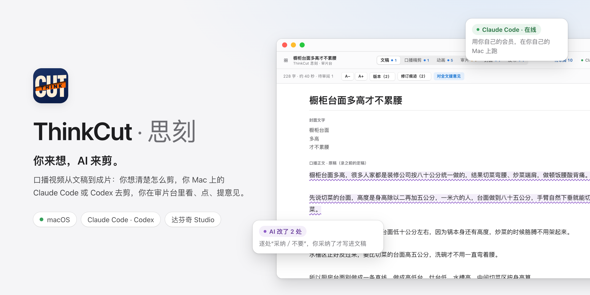
  </picture>
</p>

<p align="center">
  <b>You think. AI cuts.</b><br>Talking-head videos from script to final cut. 
  Your own Claude Code or Codex drafts everything on your Mac; you review, approve and comment on a local “review desk”; editing and export happen in DaVinci Resolve Studio.<br>Built and maintained by one independent developer.
</p>

<p align="center">
  <a href="README.md">中文</a> ·
  <a href="#install">Install</a> ·
  <a href="#how-it-works">How it works</a> ·
  <a href="#security">Security</a> ·
  <a href="RELEASE_NOTES.md">Release notes</a> ·
  <a href="LICENSE.md">License (noncommercial)</a>
</p>

> [!NOTE]
> Early version, verified only on the author's own machines, and **not a one-step install** (transcription and cutting need a runtime environment you prepare yourself). The full documentation and the interface are in Chinese; this page is the English overview. Read [Current limitations](#current-limitations) first.

## Why “ThinkCut”: you think, AI cuts

Much of today's AI video editing turns out AI slop: one click, a finished video that looks the part, and no human thinking in it. If AI could really produce, in one click, the video most people want, there would be no need for editing at all — let alone “AI editing”. So I don't believe in 100% AI editing.

What gives a video its value is a person's thinking: what to say, how to cut it, what it should become. That is the **Think**, and it belongs to people.

The actual cutting used to take a team; learning DaVinci Resolve alone could take a year. AI can do that part now. That is the **Cut**, and it goes to the AI.

Until fully automatic editing truly arrives, ThinkCut exists to turn your Think into a Cut faster: once you know what you want, you can make it — no need to learn Resolve first.

## Highlights

**Edit the text, and you've edited the video.** After the AI's first cut, the voice-over becomes a page of text: drag over words to cut them, drag over struck-out words to bring them back. Nothing touches the timeline until you click “Save to Resolve”.

<picture>
  <source media="(prefers-color-scheme: dark)" srcset="docs/images/text-edit-dark.png">
  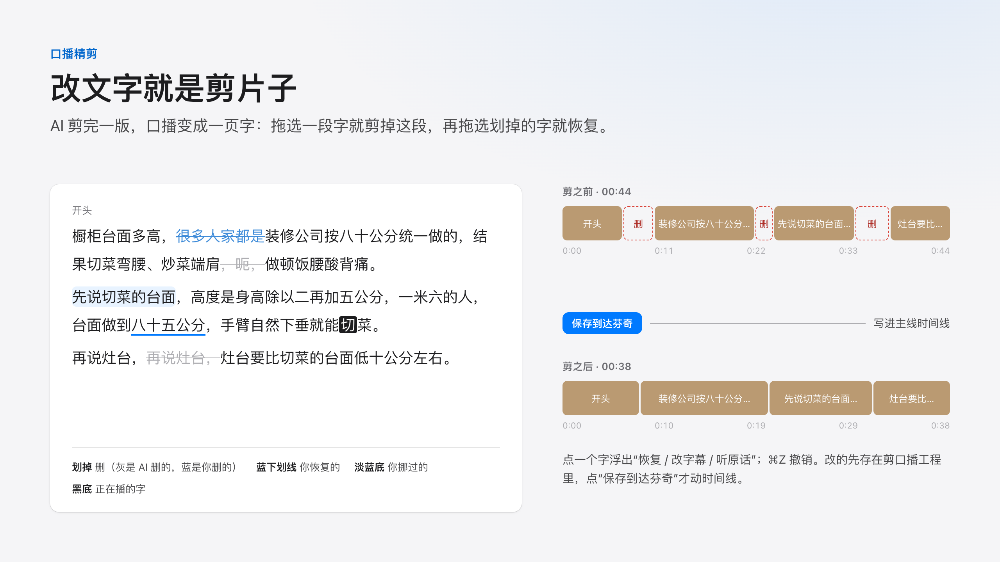
</picture>

**The AI runs on your Mac, on your own subscription.** ThinkCut ships no model and never handles your account or password. Clicking “Submit to AI” starts the Claude Code or Codex you are already signed in to. There is no ThinkCut server and no ThinkCut account.

<picture>
  <source media="(prefers-color-scheme: dark)" srcset="docs/images/local-ai-dark.png">
  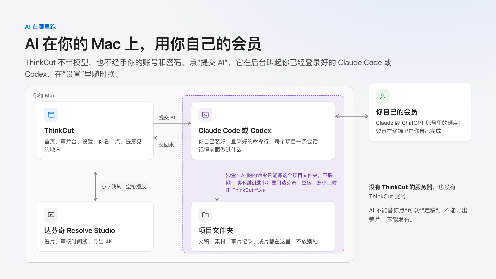
</picture>

**The AI never gets the keys.** API keys for speech recognition (Doubao) and the publishing tool (Yixiaoer) live in the macOS Keychain. When the AI needs transcription, TTS, a draft upload or DaVinci Resolve, it files a request and ThinkCut runs it, returning only the result.

<picture>
  <source media="(prefers-color-scheme: dark)" srcset="docs/images/keys-dark.png">
  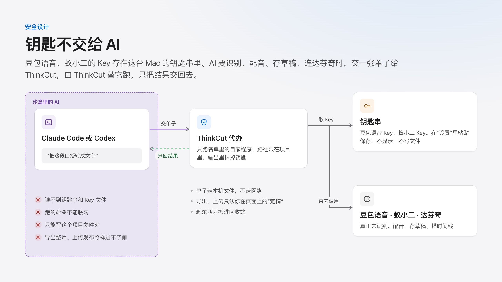
</picture>

## What it does

Each video is a “project”. Five steps from script to video; at each one the AI goes first, and you look, approve, or comment directly on the text. The AI only changes the column you sent it.

<picture>
  <source media="(prefers-color-scheme: dark)" srcset="docs/images/steps-dark.png">
  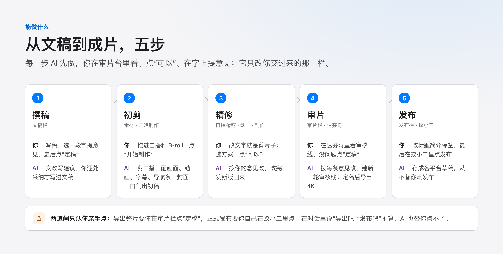
</picture>

| Step | You | The AI |
|---|---|---|
| **1 Script** | Create a project on the home page, write or paste the script, select text and comment, accept or reject each suggested rewrite, then “Finalize” | Proposes rewrites (nothing is written until you accept); after you finalize, names the project and tells you where to put footage |
| **2 First cut** | Drag in the voice-over recording and B-roll, click “Start” | Cuts the voice-over, adds B-roll (generated placeholders where footage is missing), animations, text overlays and sound effects, the chapter bar, a review timeline in Resolve, covers, titles/descriptions/tags — in one go, without stopping to ask; uncertain choices are listed as assumptions; uses machine TTS as a placeholder if nothing is recorded yet |
| **3 Refine** | Review each column, approve, pick options, comment | Changes only the column you submitted and sends back a new version; asks you with option buttons when unsure |
| **4 Review** | Watch the review timeline in Resolve, comment on the full transcript, then “Finalize” (this is the permission to export) | Revises per comment, building a new review timeline each round; after you finalize, exports 4K |
| **5 Publish** | Edit title/description/tags, click “Save as Yixiaoer draft”; **you** press publish in Yixiaoer | Exports, archives, and saves per-platform drafts — **never publishes** |

## Current limitations

| Works out of the box | Not yet / bring your own |
|---|---|
| Linking the 5 skills to Claude Code / Codex | **Transcription, cutting into Resolve, automatic matting** need a "runtime environment" (Python 3.12, forced-alignment env and model, matting env, the Resolve connector) that the author installed by hand; from-scratch setup is not documented or tested elsewhere |
| Your own creator profile ("IP"), projects, home page, review desk (writing and revising the script with AI), settings, AI chat sidebar | Fonts in `素材库/字体/` and the sound-effect library in `素材库/音效素材/` are not distributed (`bash bin/fetch_fonts.sh` downloads the open-source fonts) |
| Cover layout, building the macOS app | Publishing only supports the Chinese tool “蚁小二” (Yixiaoer) |
| Offline tests | |

## Requirements

A Mac (the author uses Apple silicon; minimum chip and macOS version not yet confirmed), **DaVinci Resolve Studio** (the paid version — the free one lacks the scripting API and voice isolation), **Claude Code or Codex** signed in with your own account, and for cutting, a **Doubao speech** API key (ByteDance Volcano Engine). Also Xcode command line tools, Homebrew, `ffmpeg-full`, the system Python 3.9 with `requirements/base.txt`; optional: Node 22+, Chrome, HyperFrames, Blender. The full table (what each service is for, whether it costs money, where to sign up, what happens without it) is in the [Chinese README](README.md#需要什么).

## Install

```bash
bash bin/setup_mac.sh --links            # link the 5 skills for Claude Code / Codex
python3 studio/skill/thinkcut-edit/scripts/thinkcut_edit.py doctor   # check what's missing
python3 bin/thinkcut_config.py new <name>  # create your own profile ("IP")
bash bin/build_app.sh --install           # optional: build ThinkCut.app (unsigned: right-click → Open the first time)
```

Then open **Settings** (top right of the home page) to sign in to Claude Code / Codex — a Terminal window runs the official login and you sign in yourself — and paste the Doubao and Yixiaoer keys (stored in the Keychain, never shown or written to files). Never paste a key to the AI.

Offline tests (also run on GitHub Actions):

```bash
python3 -m pip install --user -r requirements/dev.txt
bash bin/fetch_fonts.sh
python3 bin/test_all.py
```

## How it works

> Screenshots come from a demo project made for this page; light or dark follows your GitHub theme. The interface is in Chinese.

### Home

<picture>
  <source media="(prefers-color-scheme: dark)" srcset="docs/screenshots/home-dark.png">
  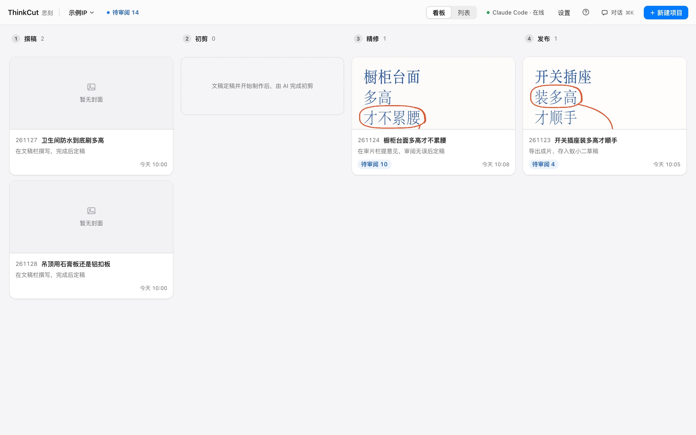
</picture>

Every project on a four-column board (or a list). Double-click a card to open its review desk in the same window; ⌘W goes back. Right-click to rename, mark done, or move to the recycle folder — never a permanent delete.

### Review desk

One local page per project, with columns for Script, Voice-over edit, Animation, Review, Cover and Publish. Four states, one color each: waiting for you (blue), not yet submitted (orange), AI working (purple), finalized (green). Only what you click counts — the AI can't approve or finalize for you.

<picture>
  <source media="(prefers-color-scheme: dark)" srcset="docs/screenshots/script-dark.png">
  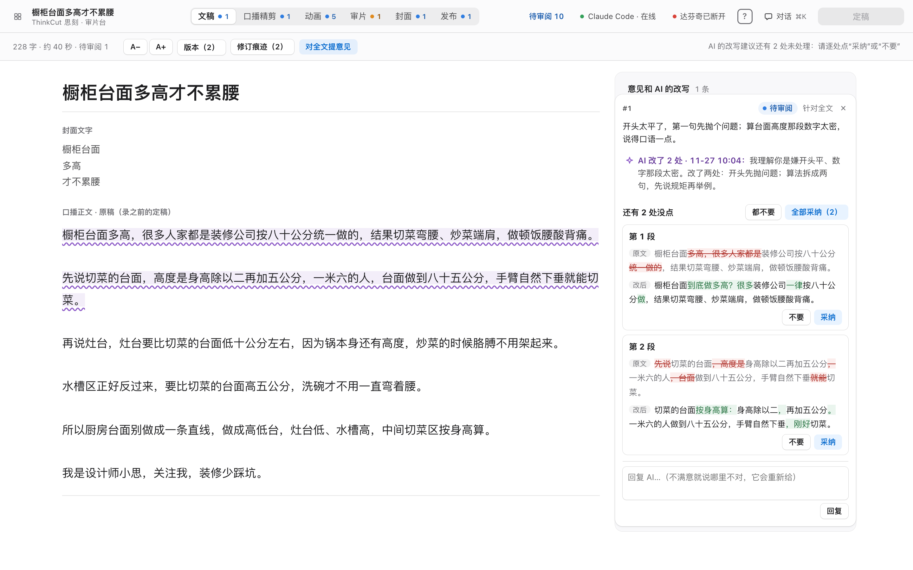
</picture>

<picture>
  <source media="(prefers-color-scheme: dark)" srcset="docs/screenshots/talk-edit-dark.png">
  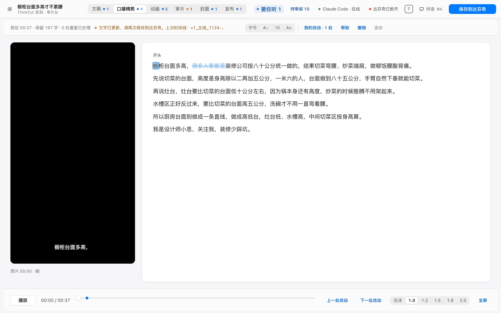
</picture>

<picture>
  <source media="(prefers-color-scheme: dark)" srcset="docs/screenshots/review-dark.png">
  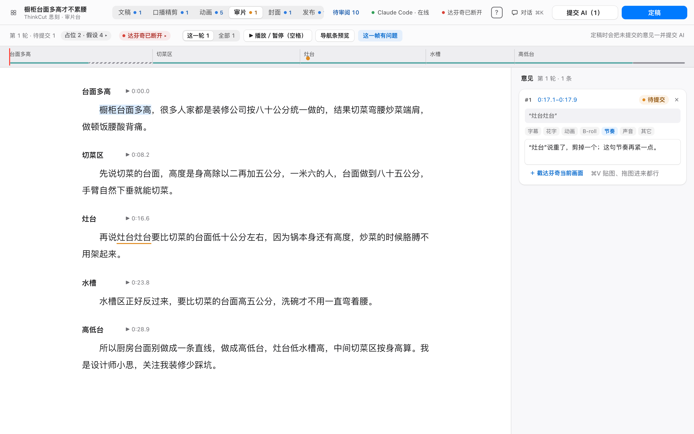
</picture>

<picture>
  <source media="(prefers-color-scheme: dark)" srcset="docs/screenshots/cover-dark.png">
  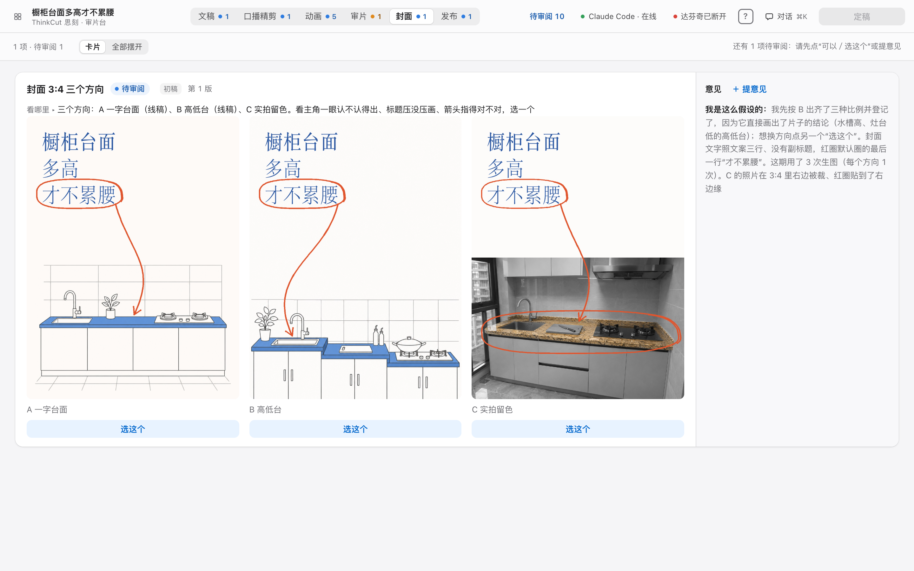
</picture>

### Working with the AI

<picture>
  <source media="(prefers-color-scheme: dark)" srcset="docs/screenshots/ai-working-dark.png">
  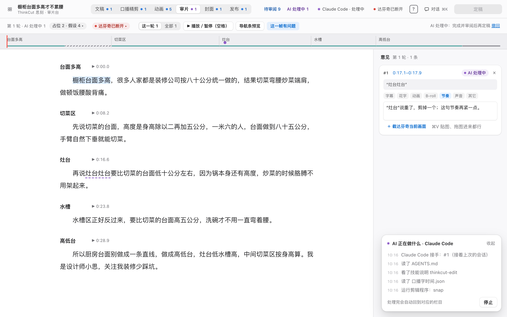
</picture>

Click “Submit to AI” and the desk runs your chosen AI in the background, in the project folder, continuing the project's own session. A small panel shows what it is doing, with a Stop button. If the AI is offline, your submission is kept and starts once you sign in. You can still work the old way, too: open Claude Code or Codex in this folder, have it read [AGENTS.md](AGENTS.md), and let it wait for your clicks (`thinkcut_edit.py home --wait`).

<picture>
  <source media="(prefers-color-scheme: dark)" srcset="docs/screenshots/chat-dark.png">
  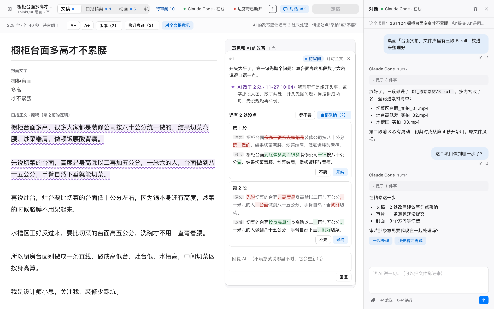
</picture>

Press **⌘K** for the chat sidebar. On a project it shares the project's session (“bring in the three B-roll clips on my Desktop”, “where are we?”); on the home page it handles creating projects and finding things. Exporting, publishing and finalizing are never done from chat — they only count when you click them on the page.

## Security

- **Two gates only you can open:** exporting the full video (finalize the Review column) and publishing (you press publish in Yixiaoer; ThinkCut only saves drafts and blocks publish commands).
- **Sandboxed AI:** the background AI can write only to the project folder and temp; its commands have no network (Claude Code's built-in sandbox; Codex with network off); no permission-bypass flags.
- **Keys stay out of reach:** keys live in the Keychain and the AI's environment can't read them. ThinkCut runs allow-listed programs on its behalf, limited to the project folder, scrubbing keys from output.
- **Your files stay local:** source footage is never modified; hand edits in Resolve are never overwritten; deleting a project moves it to a recycle folder.

## Folder names

Program folders are English (`core/` voice-over cutting and Resolve overlays, `studio/` the review desk and edit skill, `projects/` project management, `cover/` covers, `chapters/` the chapter bar, `profiles/` creator profiles, `design/` the UI spec). Some data folders, and the project folders you see in Finder (`01_原始素材`, `02_制作`, …), are Chinese.

## License

Source-available under [PolyForm Noncommercial 1.0.0](LICENSE.md): free for personal, study, research and nonprofit use; **commercial use requires a separate license from the author**. Bundled third-party code: [THIRD_PARTY_NOTICES.md](THIRD_PARTY_NOTICES.md). Contributing: [CONTRIBUTING.md](CONTRIBUTING.md). Security reports: [SECURITY.md](SECURITY.md).

## Release notes

Per-version changes: [RELEASE_NOTES.md](RELEASE_NOTES.md) (Chinese). Illustrated release notes for users, in Chinese and English: [docs/releases/](docs/releases/), also posted on the GitHub Releases page.
