<p align="center">
  <picture>
    <source media="(prefers-color-scheme: dark)" srcset="docs/images/hero-dark.png">
    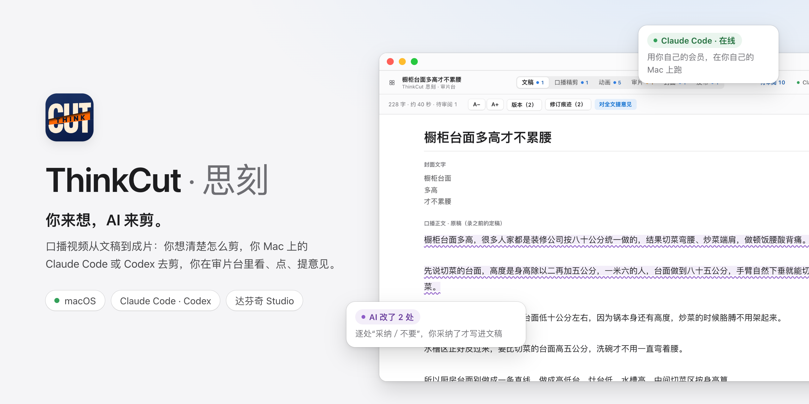
  </picture>
</p>

<p align="center">
  <b>你来想，AI 来剪。</b><br>口播视频从文稿到成片：
  你这台 Mac 上的 Claude Code 或 Codex 出初稿，你在“审片台”里看、点、在字上提意见；看片和导出在达芬奇里。<br>一个人开发和维护。
</p>

<p align="center">
  <a href="README.en.md">English</a> ·
  <a href="#安装">安装</a> ·
  <a href="#怎么用">怎么用</a> ·
  <a href="#安全设计">安全设计</a> ·
  <a href="RELEASE_NOTES.md">更新说明</a> ·
  <a href="LICENSE.md">许可证（非商用）</a>
</p>

> [!NOTE]
> 早期版本，目前只在作者自己的电脑和环境里验证过，**还不能一键装好**（转文字、剪口播要的程序环境要自己准备）。先看 [现在的限制](#现在的限制)。

## 为什么叫 ThinkCut：你来想，AI 来剪

现在很多 AI 剪辑做出来的是“AI 泔水”：一键成片，看着像那么回事，里面却没有人的想法。要是 AI 真能一键剪出大多数人想要的片子，剪辑这件事本身就不需要了，更谈不上“AI 剪辑”。所以我认为，百分之百靠 AI 的剪辑不成立。

一条片子的价值在于人的思考：讲什么、怎么剪、剪成什么样。这是 **Think**，由人来做。

具体怎么剪，以前要靠一群人，光学会达芬奇就得一年。现在这部分 AI 会了，这是 **Cut**，交给 AI。

在全 AI 剪辑真正到来之前，ThinkCut 要做的就是让你的 Think 更快地变成 Cut：你想清楚了，就能剪出来，不用先去学达芬奇。

## 三个亮点

**改文字就是剪片子。** AI 剪完一版，口播变成一页字：拖选一段字就剪掉这段，再拖选划掉的字就恢复；点“保存到达芬奇”才动时间线。

<picture>
  <source media="(prefers-color-scheme: dark)" srcset="docs/images/text-edit-dark.png">
  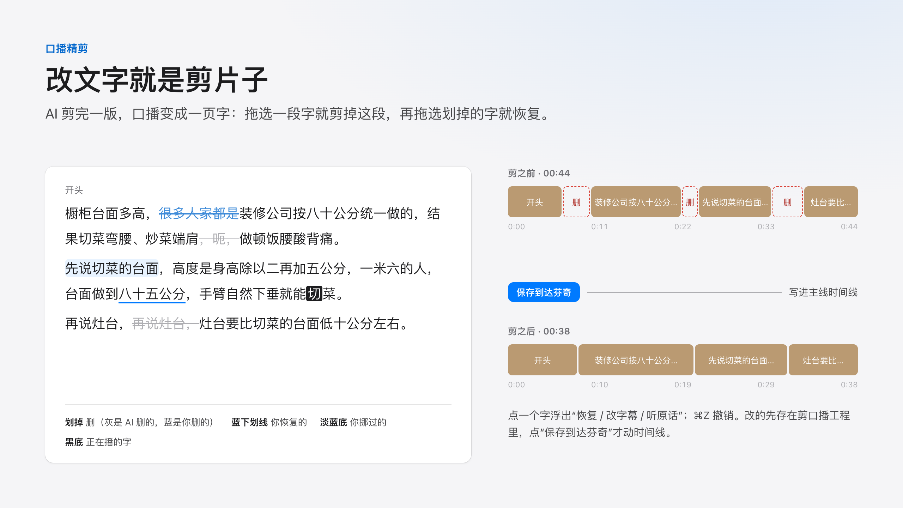
</picture>

**AI 在你的 Mac 上，用你自己的会员。** ThinkCut 不带模型，也不经手你的账号和密码；点“提交 AI”，它在后台叫起你已经登录好的 Claude Code 或 Codex。没有 ThinkCut 的服务器，也没有 ThinkCut 账号。

<picture>
  <source media="(prefers-color-scheme: dark)" srcset="docs/images/local-ai-dark.png">
  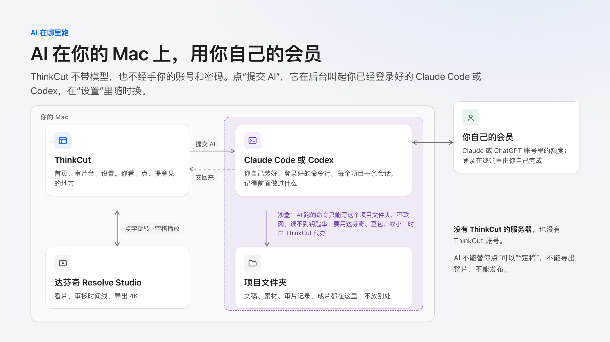
</picture>

**钥匙不交给 AI。** 豆包语音、蚁小二的 Key 存在这台 Mac 的钥匙串里；AI 要识别、配音、存草稿、连达芬奇时交一张单子，由 ThinkCut 替它跑，只把结果交回去。

<picture>
  <source media="(prefers-color-scheme: dark)" srcset="docs/images/keys-dark.png">
  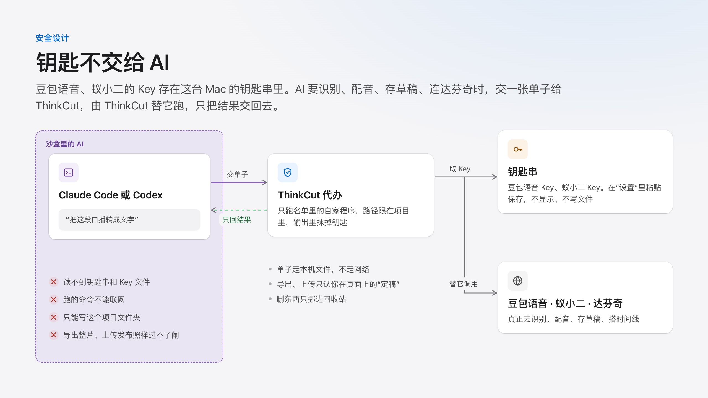
</picture>

## 能做什么

一条口播视频在程序里叫一个“项目”。从文稿到成片分五步，每一步 AI 先做，你看、点“可以”、在字上提意见；它只改你交过来的那一栏。

<picture>
  <source media="(prefers-color-scheme: dark)" srcset="docs/images/steps-dark.png">
  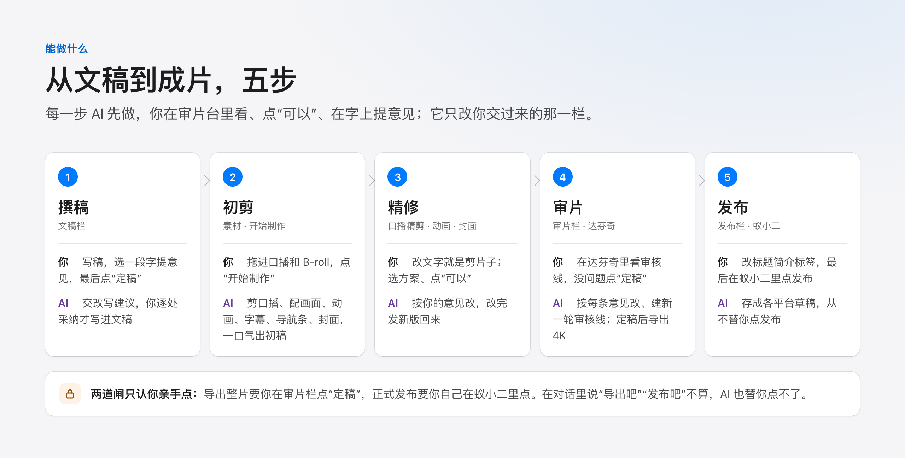
</picture>

| 步骤 | 你做什么 | AI 做什么 | 在哪点 |
|---|---|---|---|
| **1 撰稿** | 首页点“＋ 新建项目”填个题目；在文稿栏撰写或粘贴口播稿；选一段字提意见，点“提交 AI”；AI 的改写逐处点“采纳／不要”；完成后点“定稿” | 按你的意见交改写建议（**你采纳了才写进文稿**）；你定稿后“开项”：按定稿的标题改好项目名、登记标题和封面文字，告诉你素材放哪 | 首页“新建项目”→ 文稿栏 →“提交 AI”→“定稿” |
| **2 初剪** | 把口播录像、B-roll 拖进文稿栏下面的素材条（或填写路径），补充说明写一句，点“开始制作” | 整理素材，一口气做完初稿：剪口播、配画面（缺的先用生成图占位）、动画、花字音效、章节导航条、达芬奇审核时间线、封面、标题简介标签。**中间不来问你**；拿不准的按最合理的做，写在“我是这么假设的”里；没录口播就用机器配音占位 | 文稿栏的素材条 →“开始制作” |
| **3 精修** | 在口播精剪、动画、封面等栏看、点“可以”、选方案、提意见，点“提交 AI” | 只处理你交过来的那一栏，改完发新版回来；拿不准就回问你（卡片上有选项按钮） | 各栏 →“提交 AI” |
| **4 审片** | 在达芬奇里看审核线，在全文上提意见；没问题了在审片栏点“定稿” | 按每条意见改，每改一轮建一条新审核线；你定稿后导出 4K 成片 | 审片栏 →“提交 AI”→“定稿” |
| **5 发布** | 在发布栏看标题简介标签、选只存草稿还是定时发布，点“存到蚁小二草稿”；最后**你自己在蚁小二里点发布** | 导出 4K 成片、存档达芬奇工程、封存交付包、存成各平台草稿（**只存草稿，从不点发布**） | 发布栏 →“存到蚁小二草稿” |

首页的四列（撰稿 → 初剪 → 精修 → 发布）就是这几步；审片算在“精修”那一列里。项目完成后，在首页右键“移到‘已完成’”。

## 现在的限制

这是一个**早期版本**，目前只在作者自己的电脑和环境里验证过，**还不能一键装好**。拿到代码后：

| 能用 | 现在用不了（或要自己补） |
|---|---|
| 链接 5 个技能给 Claude Code／Codex | **转文字、剪口播放进达芬奇、自动抠人**：要一套“程序环境”（Python 3.12、声学对齐环境和模型、抠人环境、达芬奇连接程序），作者是自己装好放在 `环境/` 里的，**不在代码里**；从零装起来的步骤还没整理、也没人在别的电脑上走通过 |
| 建自己的 IP 配置、建项目、首页、审片台（文稿栏撰稿、和 AI 改稿、定稿）、设置页、AI 对话侧栏 | `bash bin/setup_mac.sh` 的“程序环境”一步会停在“没有环境原件：<程序目录>/环境” |
| 封面排版（有底图时）、装成 Mac 程序 | 人挡字用的开源字体（`素材库/字体/`）、音效库（`素材库/音效素材/`）不随代码分发，要自己放（见下一节） |
| 离线测试（放好字体和音效后） | 发布只对接了“蚁小二”这一个工具 |

遇到问题，欢迎把现象和你的环境一起反馈（见 [CONTRIBUTING.md](CONTRIBUTING.md)）。

## 需要什么

一台 Mac（作者在 Apple 芯片的 Mac 上使用；最低芯片和系统版本：待确认）、**DaVinci Resolve Studio**（达芬奇付费版）、**Claude Code 或 Codex**（用你自己的账号和会员），剪口播还要**豆包语音**的 Key。下面按代码里实际用到的整理。价格都**以服务商为准**，这里不写数字。“待确认”的是作者还没验证过的。

### 外部服务和账号

| 名字 | 拿来干什么（哪一步） | 必需？ | 花钱吗 | 去哪开通 | 怎么配进程序 | 没有它会怎样 |
|---|---|---|---|---|---|---|
| **Claude Code 或 Codex** | 驱动整个流程：读说明、跑命令、改项目 | 必需 | 用你自己账号的额度 | 各自官网 | 用你自己的账号登录即可（“设置”里点“登录”会弹出终端）；`bash bin/setup_mac.sh --links` 把技能链接到 `~/.claude/skills`、`~/.codex/skills` | 没人干活，只能自己敲命令 |
| **Codex 的生图** | 出封面底图、初稿里缺画面时的占位图（程序调用 `codex exec`） | 做封面时必需 | 用你 Codex 账号的额度；失败也算一次 | 同上 | 装好、登录好 Codex 就行；也可以用环境变量 `THINKCUT_IMAGE_GEN` 换成别的生图命令 | 封面和占位图出不来。只用 Claude Code 时封面怎么出：待确认；需要哪种 Codex 账号：待确认 |
| **豆包语音：语音识别** | 剪口播的第一步：把口播转成带时间的文字 | 剪口播必需 | 按次计费（识别前会提示） | 火山引擎“豆包语音”新版控制台（console.volcengine.com/speech）；**火山方舟的 Key 不能用** | 首页右上“设置”里粘贴保存（存进这台 Mac 的钥匙串，每台 Mac 各配一次），点“测试”实测一次；或在终端跑 `python3 core/bin/doubao_credentials.py`。以前存在 `core/secrets/doubao_api_key` 的会在第一次用时自动导入钥匙串，旧文件不删 | 体检写“可以转文字：否”，剪不了口播 |
| **豆包语音合成 2.0（seed-tts-2.0）** | 只有文案、还没录口播时，用机器配音占位做初稿 | 可选 | 按字数计费；`--dry-run` 只算字数不花钱 | 同上 | 同上，和识别共用一个 Key；音色在 IP 配置里（`配音.音色`） | 没录口播时出不了带声音的初稿 |
| **DaVinci Resolve Studio（达芬奇付费版）** | 剪口播放进时间线、配 B-roll、花字音效、审核时间线、修音（人声隔离）、导出 4K | 必需 | 付费软件 | Blackmagic 官网，自己安装并打开过一次 | 程序通过达芬奇自带的脚本接口连它（`/Library/Application Support/Blackmagic Design/DaVinci Resolve/Developer/Scripting`）；审片台里“按空格让达芬奇播放”要给系统 Python 开“辅助功能”权限（第一次会弹提示） | 免费版没有脚本接口和人声隔离，大部分步骤做不了（具体卡在哪一步：待确认）。作者用的是 21.1.1／21.1.2，别的版本：待确认 |
| **达芬奇连接程序（davinci-resolve-mcp）** | 搭时间线、加字幕 | 必需 | 免费开源 | GitHub 上的 davinci-resolve-mcp（作者用的固定版本见 `core/bin/setup_mac.sh`） | 属于“程序环境”的一部分，见上面“现在的限制” | 放不进达芬奇 |
| **蚁小二（发布工具）** | 把成片、封面、标题简介标签存成各平台的**草稿** | 可选 | 以服务商为准；要哪种账号：待确认 | 蚁小二官网；还要装它的命令行工具（npm 包 `@yixiaoermail/cli`，版本要求：待确认） | `bash projects/bin/setup_mac.sh` 装好 `yxer-safe`，再在“设置”里粘贴 Key 保存，或运行 `yxer-safe key set`；Key 存在这台 Mac 的**登录钥匙串**里，不落盘、不进存档 | 发布栏“存到蚁小二草稿”做不了，其余照常；你可以自己手动发 |

<details>
<summary><b>本机工具</b>（ffmpeg、Python、Node、Chrome、HyperFrames、Blender、模型、字体）</summary>

| 名字 | 用在哪 | 必需？ | 说明 |
|---|---|---|---|
| Xcode 命令行工具、Homebrew | 装其它东西 | 必需 | 要输入电脑密码，自己装 |
| ffmpeg（要带 zscale、prores、x264）、ffprobe | 几乎每一步：切片、转码、字幕、导出 | 必需 | 安装脚本用 Homebrew 装 `ffmpeg-full` |
| 系统自带的 `python3`（3.9）＋ numpy、Pillow、fontTools | 审片台、首页、封面、大部分程序 | 必需 | 程序按 Mac 自带的 Python 3.9 写 |
| Python 3.12 | 声学对齐、抠人这两个独立环境 | 剪口播、抠人必需 | 在“程序环境”里 |
| Node 22 或以上、Google Chrome（或 Chromium、Edge） | 出网页动画、无头截图 | 做动画必需 | |
| HyperFrames（`npm install -g hyperframes@0.9.39`） | 网页动画镜头 | 有网页动画镜头才要 | 模板在 0.9.39 上验证过 |
| Blender | 三维动画镜头 | 有 Blender 镜头才要 | 放“应用程序”，或用环境变量 `BLENDER` 指过去；作者用 5.2 |
| 声学对齐模型 Qwen3-ForcedAligner-0.6B（约 1.2 GB） | 把字和声音对齐到每个字 | 剪口播必需 | 在“程序环境”里；可选的 silero-vad 让气口判断更准 |
| 抠人模型 RVM（rvm_mobilenetv3） | “人挡字”效果（人站在大字前面） | 用到人挡字才要 | 在“程序环境”里 |
| 字体 | 字幕冬青黑体、花字苹方、封面宋体＋冬青黑体 | 必需 | 都是 macOS 自带的，不用另装 |
| `素材库/字体/` | 人挡字的风格字体 | 用到人挡字才要 | `bash bin/fetch_fonts.sh` 自动下载放好（约 160 MB，按指纹核对版本）；或自己下载放进去：思源黑体 SourceHanSansSC-Heavy/Light.otf、思源宋体 SourceHanSerifSC-Heavy.otf、Inter 的 InterDisplay-*.ttf（放 `Inter/` 子文件夹），都是 SIL OFL 免费字体 |
| `素材库/音效素材/` | 花字音效 | 做花字音效才要 | 作者自己的音效库，不随代码分发；放你自己的，或用环境变量 `AI_EDIT_SFX_DIR` 指过去 |

</details>

<details>
<summary><b>磁盘、NAS 和网络</b></summary>

- **放哪**：作者把程序、程序环境和项目都放在 NAS 上，多台 Mac 共用。macOS 27.2 起系统不让直接运行 NAS 上的程序，所以每台 Mac 有一份环境运行副本（`~/Library/Application Support/ThinkCut/环境`，第一次约 3 GB，用 `bash bin/sync_env.sh` 恢复）。只用本机硬盘、不用 NAS 时怎么配：待确认（项目放哪可以在 IP 配置里改，见“多个 IP”）。多人共用 NAS 时，豆包 Key 文件的权限怎么设：待确认。
- **空间**：一个项目的成片可能好几 GB；4K 抠人的中间帧一帧约 116 MB、3 秒约 10 GB（放本机临时目录，用完就删）。程序写大文件前会估算，本机剩余空间不够“要写的量＋5 GB”就停下。建议本机留出几十 GB（具体量：待确认）。
- **网络**：豆包识别和配音、Codex 生图、蚁小二上传、安装时的下载都要联网。安装脚本默认用国内镜像（pip 清华、npm npmmirror、Hugging Face hf-mirror），`--no-mirror` 关掉。蚁小二的命令行不认代理，靠代理上网的机器上传会失败。

</details>

## 安装

在终端里进入这个文件夹，按顺序做：

1. **装基础工具**：Xcode 命令行工具（`xcode-select --install`）、Homebrew（见 brew.sh）、DaVinci Resolve Studio（官网装好后打开一次）、Claude Code 或 Codex（登录你自己的账号）。

2. **链接技能**（让 Claude Code／Codex 认得这个程序）：

   ```bash
   bash bin/setup_mac.sh --links
   ```

   会在 `~/.claude/skills` 和 `~/.codex/skills` 下建 5 个链接：`thinkcut-edit`（剪辑总入口）、`thinkcut-project`（建项目、整理素材、存档）、`thinkcut-cover`（封面）、`thinkcut-upload`（上传草稿）、`thinkcut-feedback`（收尾反馈）。

   不带 `--links` 时（`bash bin/setup_mac.sh`）还会装上传工具、恢复程序环境、跑体检——程序环境那一步现在会停下，见“现在的限制”。

3. **体检**：看哪些齐了、哪些缺：

   ```bash
   python3 studio/skill/thinkcut-edit/scripts/thinkcut_edit.py doctor
   ```

   ```bash
   bash core/bin/setup_mac.sh --check
   ```

   第二条只检查、不安装，逐项列出剪口播这一块缺什么。

4. **建你自己的 IP 配置**（颜色、字体、配音音色、发布平台、给 AI 看的口吻规矩都在里面，见下面“多个 IP”）：

   ```bash
   python3 bin/thinkcut_config.py new 你的名字
   ```

   然后把 `profiles/公共.json` 里的 `"默认IP"` 改成它（或写进只在这台电脑上的 `profiles/本机.json`：`{"默认IP": "你的名字"}`）。不建的话用自带的 `示例IP`。

5. **装成 Mac 程序**（可选，推荐）：

   ```bash
   bash bin/build_app.sh --install
   ```

   会做出一个叫 **ThinkCut** 的程序放进“应用程序”。它只用系统自带的工具编译，**没有苹果的签名**，所以**第一次打开要在“应用程序”里右键它 →“打开”**，macOS 问要不要打开时点“打开”；以后直接双击。想放进程序坞：打开后在程序坞图标上右键 →“选项”→“在程序坞中保留”。程序记住了是从哪个文件夹做出来的；把整个文件夹挪了地方，就在新位置再跑一次这条命令。

   改程序的人：在开发用的程序文件夹（文件夹名以“-开发”结尾，或 git worktree）里跑这条命令，做出来的是 **ThinkCut 开发版**——图标右下角有橙色“开发”角标，页面标题旁一直挂橙色“开发版”，系统当它是另一个程序，首页用 8762 端口，可以和正式版同时开、互不影响。

   不装程序也行：在浏览器里打开首页（见“首页”一节）。

6. **在“设置”里配 AI 和 Key**（首页右上“设置”，或审片台右上 AI 状态里的“打开设置”），见下面“设置”一节。**不要把任何 Key 粘贴给 AI 或写进文件。**

## 怎么用

> 下面的截图来自一个专门截图用的演示项目（内容是通用的装修话题），浅色、深色跟着你的 GitHub 主题切换。

### 首页

<picture>
  <source media="(prefers-color-scheme: dark)" srcset="docs/screenshots/home-dark.png">
  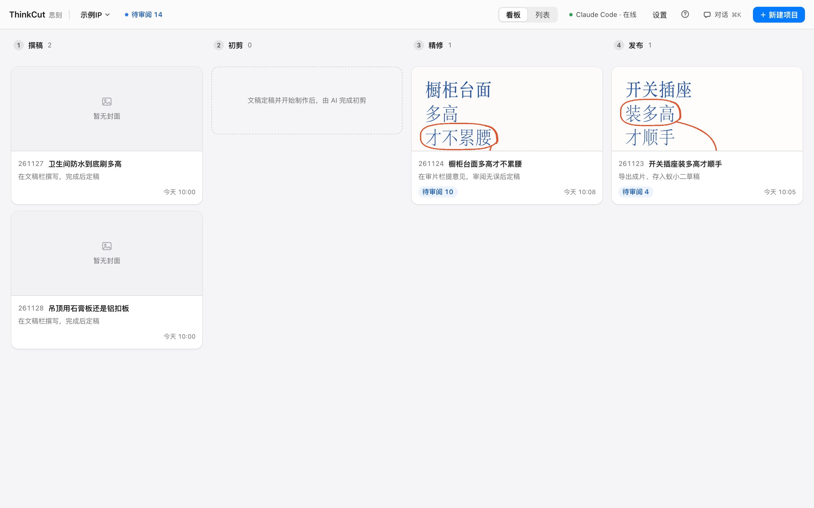
</picture>

所有项目的入口。双击 ThinkCut 程序打开，或在终端里运行 `python3 studio/skill/thinkcut-edit/scripts/thinkcut_edit.py home`（默认在 `http://localhost:8760`）。四列看板按项目正在的那一步放卡片；**双击**一张卡就在同一个窗口里进到它的审片台，⌘W（浏览器里点后退）回首页。右上角能切到列表、点“＋ 新建项目”、打开“设置”和“对话 ⌘K”。

<details>
<summary>首页的完整用法</summary>

放项目的文件夹按你 IP 配置里的“片子文件夹”（配置键名，未改），也可以加 `--root <文件夹>`。

<picture>
  <source media="(prefers-color-scheme: dark)" srcset="docs/screenshots/home-list-dark.png">
  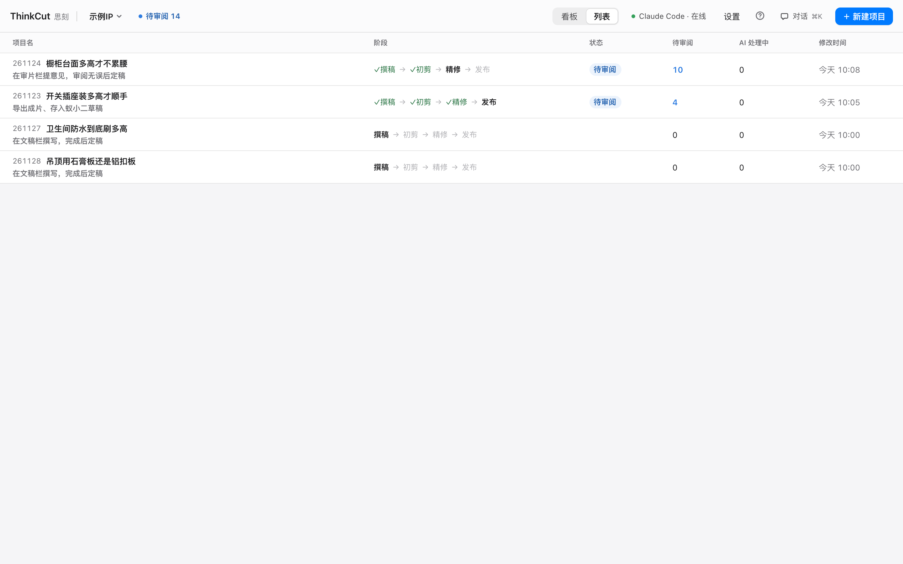
</picture>

- **看板（默认）**：四列 撰稿 → 初剪 → 精修 → 发布，每个项目按它正在的那一步放进一列。卡片上：封面小图（还没有就写“暂无封面”）、编号＋项目名、**这一步该做什么**一句、状态和件数、最后改动时间。
- **列表**：右上角切到“列表”，一行一条，四步做到哪一目了然（✓ 绿字做完、粗字正在做、灰字没到）。选哪种看法记在这台电脑上。
- **顶栏**：“待审阅 N · AI 处理中 N”是所有项目加起来的；右边是当前用的 AI 和它的状态（如“Claude Code · 在线”，点开看详情、直接换 AI）、“设置”、“?”（怎么用）、“对话 ⌘K”、“＋ 新建项目”。左上角切换、新建、删除 IP。
- **打开一个项目**：**双击**卡片（或选中后回车、右键“打开”），就在**同一个窗口**里进到它的审片台；回首页：在 Mac 程序里按 ⌘W，在浏览器里点后退。一次只开一个项目（达芬奇一次也只开一个工程）。上次开的那张卡有蓝边。
- **新建项目**：点“＋ 新建项目”，只填一个题目（可以空着，叫“未命名”）。程序建好标准的项目文件夹（名字是“今天的 6 位日期编号＋空格＋题目”），直接进到这个项目的文稿栏。不需要 AI 在场。
- **右键一个项目**：打开、在访达中显示、重命名（前面的编号不变）、移到“已完成”／移回“进行中”、复制项目名、移到回收站。**删除不是永久删**：整个项目文件夹挪到同一块盘的 `#recycle/ThinkCut/`，挪完底下有“撤销”。改名、移动、删除前会先停掉这个项目的审片台；登记过达芬奇库的项目做这些时要先退出达芬奇。
- **素材**：文稿定稿后，在那个项目文稿栏的素材条里放素材（见下面“文稿”）。

</details>

### 审片台：所有栏通用的规矩

每个项目一个只在你电脑上打开的网页。顶上一条工具栏：左边项目名（左边的小图标回首页）；中间一排**栏目**（文稿／口播精剪／动画／审片／封面／发布），每个旁边一个状态点和数字，按住能拖动换顺序（所有项目一样，右键恢复默认）；右边 AI、达芬奇两个状态灯、“对话”、“?”和这一栏的**主按钮**。窗口窄或打开对话栏时，栏目一直完整显示，AI 和达芬奇的状态先收成小圆点（点开照样能看、能换），再窄栏目可以左右滑。

- **4 个状态**，全站同一套颜色：**待审阅**（蓝，AI 发来了新东西等你看）、**待提交**（橙，你点了、写了还没提交）、**AI 处理中**（紫）、**✓ 已定稿**（绿）。尚未开始的栏整栏为灰色、写“未开始”。顶栏“待审阅 N”＝待审阅＋待提交，点它跳到第一处。
- **动作只有三种**：项上的“**可以**”／“**选这个**”；“**提意见**”（边写边自动保存）；工具栏右上的**主按钮**。
- **主按钮**跟着下一步变：有待提交的 →“**提交 AI（N）**”（只发这一栏）；这一栏能定稿了 →“**定稿**”（发布栏是“存到蚁小二草稿”）；已定稿 →“✓ 已定稿 · 时间”（旁边“取消”）。灰的时候，下面一行右边写着为什么。“提交 AI”和“定稿”可以分开点：不提交 AI 也能直接定稿，定稿时会把你选的、写的一起提交给 AI。定稿以后这一栏内容又变了（AI 换新版、你又改字），要重新定稿。
- **你点的才算数**：你在页面上点“可以”就是确认，不用再在对话里说；AI 不能替你点。
- **提意见＝一段对话**：选中的字、点的那一帧只是告诉 AI “大概在这儿”，AI 会按意思判断改多大范围（只这一句、连上下文、全片同类的地方）；拿不准它会回问，卡片上给几个选项按钮，点一个就是回答，也可以接着写字、⌘V 贴图、把图拖进来。
- **初稿记号**：卡片上灰色虚线小字“初稿”（AI 按自己判断做的）、“占位”（用了机器配音或生成图，以后换真的）；“我是这么假设的：……”是 AI 拿不准时的做法，不对就提意见。
- 浮在页面上的东西（大图、对比、帮助等）点外面空白处或按 Esc 就关。

### 文稿

<picture>
  <source media="(prefers-color-scheme: dark)" srcset="docs/screenshots/script-dark.png">
  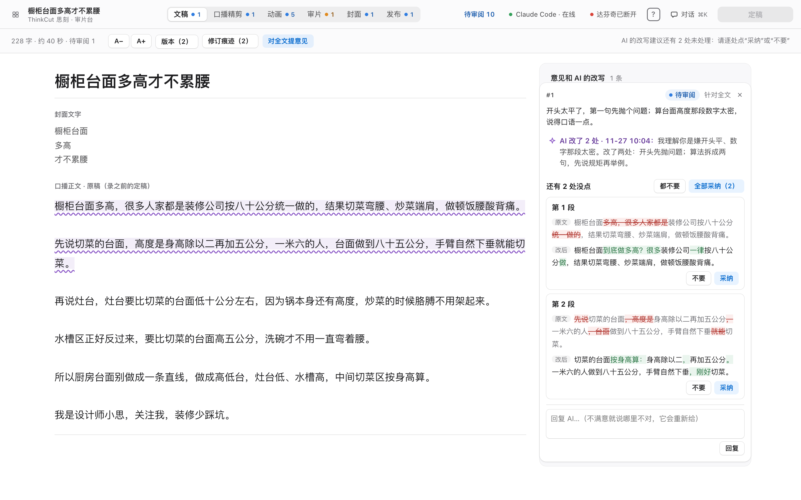
</picture>

写口播稿、和 AI 一起改、定稿。选中一段字点“＋ 提意见”（或“对全文提意见”），写意见、点“提交 AI”；AI 交回来的是**改写建议**，逐处“原文 → 改后”，你点“采纳”才写进文稿。定稿后在下面的素材条放素材，点“**开始制作**”，AI 才开始初剪。

<details>
<summary>文稿栏的完整用法</summary>

- **干嘛的**：一开始就有，项目刚建、甚至只有一个题目时就能用。读写的是项目里的文案文件 `03_成片/<项目名>.md`，自动保存。
- **怎么写**：左边三块——标题、封面文字（一行一行）、口播正文（一个自然段空一行；`###` 小标题和 `>` 备注是灰字，不算口播）。正文还空着时可以直接把一大段贴进正文，自动分出标题和封面文字（只填空着的，存成一版可退回）。上面写着总字数和估计时长，“A− A+”调字号。
- **和 AI 改**：选中一段字，点冒出来的“＋ 提意见”，或点“对全文提意见”（比如只写了题目，让 AI 先写一版）。右边出一张卡，写意见 →“提交 AI”。AI 交回来的是**改写建议**：卡片上逐处“原文 → 改后”（删的红、加的绿），你逐处点“**采纳／不要**”（也有“全部采纳／都不要”）。**采纳了才写进文稿**。有没点完的改写时，栏头会出“修订痕迹（N）”，点了能在正文里直接看红绿标记、逐处 ✓／✕。不满意就在卡片下面“回复 AI”。
- **版本**：每次采纳、手改、贴进来都自动留一版；“版本”里能看每一版改了哪里、退回到任何一版（退回也留一版，不丢东西）。
- **定稿**：标题和正文都写了、意见都处理完了，点右上“定稿”。AI 收到后**只开项**（按定稿的标题改项目名、登记标题和封面文字），回你一句素材放哪。
- **素材、开始制作**：定稿后栏头下面出一条“下一步：素材、开始制作”——把口播录像、B-roll 直接**拖进页面**（每个有进度条，原文件名保留，同名不覆盖），或写这台 Mac 上的路径一行一个、点“复制进来”（文件夹、特别大的文件用这个）；还想说的写在框里；然后点“**开始制作**”，AI 才开始初剪（口播精剪栏这时显示“AI 正在初剪”，做完自动换成剪辑器）。**你不点开始制作，AI 不剪。**
- **常见情况**：项目已经在做了，你又改了文稿 → 改的字会记成一件事，点“提交 AI”，它把用到这些字的地方（封面字、字幕、导航）跟着改；定稿后再改，定稿自动失效，要重新点。

</details>

### 口播精剪

<picture>
  <source media="(prefers-color-scheme: dark)" srcset="docs/screenshots/talk-edit-dark.png">
  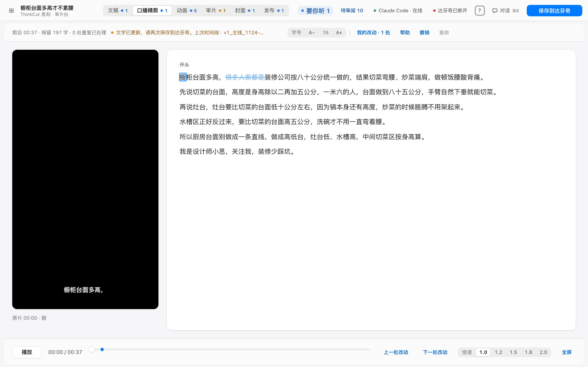
</picture>

用**改文字的方法剪口播**：拖选文字＝删掉这段，拖选划掉的字＝恢复，点一个字浮出“恢复／改字幕／听原话”。改的都先存在剪口播工程里，点右上“**保存到达芬奇**”才写进主线时间线。

<details>
<summary>口播精剪的完整用法</summary>

- **何时出现**：有了剪口播工程（录了、AI 剪过）以后；之前写“未开始”。
- **怎么用**：拖选文字＝删掉这段；拖选划掉的字＝恢复；点一个字浮出“恢复／改字幕／听原话”；拖小句下的蓝线调顺序；回车分段、删除键合并；⌘Z 撤销、⇧⌘Z 重做；“上一处／下一处改动”；底下播放条（倍速、全屏）。“我的改动”列出你改过的地方，“帮助”有完整说明。
- **标记的意思**：划掉＝删（灰是 AI 删的、蓝是你删的）、蓝下划线＝你恢复的、淡蓝底＝你挪过的、点线＝改过字幕、黑底白字＝正在播的字。
- **要你听**：AI 有声音要你听时（机器配音占位、气口新旧两种剪法、修音前后对比），右上角出“要你听 N”，点开听，满意点“可以”，不满意“提意见”。两段对比时一次只放一段。（以前单独的“配音试听”栏并到了这里。）
- **真口播优先**：项目里先用机器配音占位、后来剪好了真口播时，这一栏直接显示真口播；保存到达芬奇后项目自动换成真口播，审片栏跟着达芬奇播放的字也按新口播走。
- **1.2 倍速**：口播默认加速到 1.2 倍。只把声音做成 1.2 倍去识别和剪，放进达芬奇时用原片设 120% 速度，不重压视频（13 分钟口播从约 10 分钟、几 GB 降到十几秒）。说“这条不加速”照旧；老项目不受影响。
- **修音**：人声在口播剪好后用达芬奇整条修（在主线的副本上做，主线不动），忽大忽小的段自动补齐。
- 标题、封面文字、原稿不在这里改（在文稿栏）。

</details>

### 动画

<picture>
  <source media="(prefers-color-scheme: dark)" srcset="docs/screenshots/animation-dark.png">
  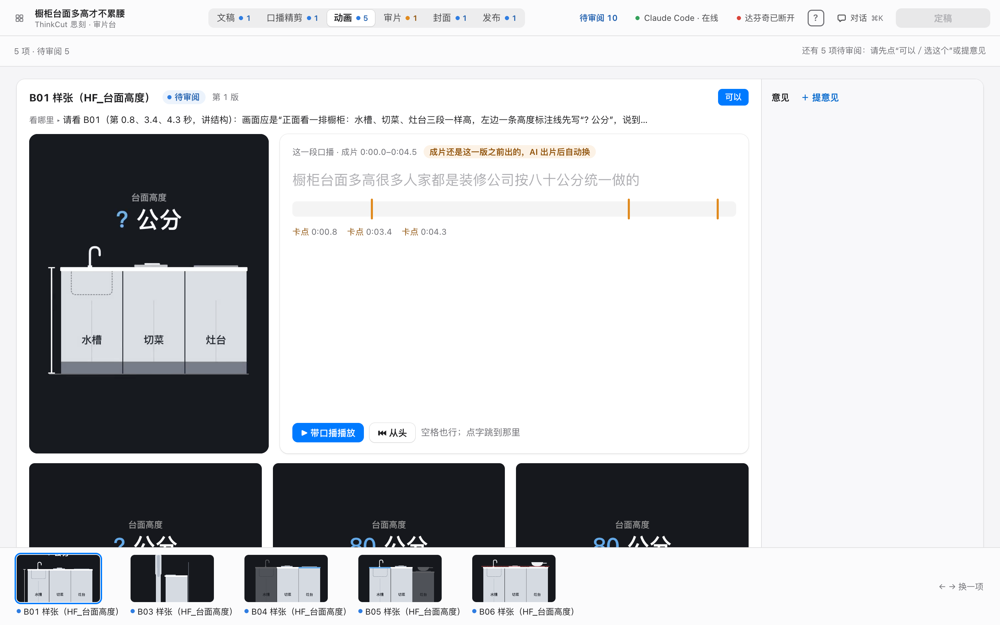
</picture>

看 AI 做的卡点动画：关系类镜头先出 2–3 张**草图**（点“选这个”），再出**样张**（点“可以”），样张点了“可以”AI 才整段出片。有成片以后每项多一块“**带口播播放**”：画面、口播的字跟着声音一个个亮、下面标出卡点，用来判断动效和卡点对不对。

<details>
<summary>动画栏的完整用法</summary>

- **怎么看**：一次看一项，底下一排小图换项（← → 键也能换）。“带口播播放”左边是这几个镜头在成片里的那一段，右边口播的字跟着声音一个个亮，下面标出卡点。空格播放／暂停，点字跳过去。一项里有几个视频时会并排一起播，能逐帧、看原尺寸。
- **常见情况**：点了“可以”之后 AI 又改了动画代码，这次确认不算数，AI 会重出样张再发给你。

</details>

### 审片

<picture>
  <source media="(prefers-color-scheme: dark)" srcset="docs/screenshots/review-dark.png">
  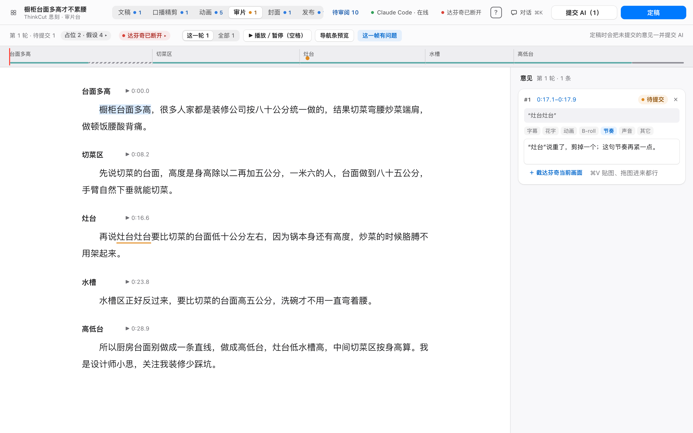
</picture>

审整片。AI 在达芬奇里建好审核时间线（改动处标绿），这一栏是**整篇口播全文**，按章节分段。**看片在达芬奇里**：点一个字达芬奇跳过去，按空格让达芬奇播放，播到哪全文里那一句就高亮。选一段字提意见，或停在一帧点“**这一帧有问题**”。都看过了点“**定稿**”——**这就是整片导出的许可**，不点，AI 不导出。

<details>
<summary>审片栏的完整用法</summary>

- **和达芬奇联动**：点一个字，达芬奇跳到那里；按空格（或“播放／暂停”）达芬奇播放（第一次要给系统 Python 开“辅助功能”权限，页面会说怎么开）；播到哪，全文里那一小句就高亮。上面一条全片时间条：章节、动画／实拍／图片镜头的区间、每条意见的位置，点哪里达芬奇跳哪里。
- **提意见**：选中一段字 →“＋ 提意见”，可以点一个类型（字幕／花字／动画／B-roll／节奏／声音／其它）；看到画面问题就停在那一帧点“**这一帧有问题**”（会截达芬奇这一帧）。卡片上能再截图、贴图、拖两头的圆点调范围。写完点“提交 AI”。
- **轮次**：每改一轮 AI 建一条新审核线，默认看“这一轮”，“全部”能回看以前的。旧轮次的意见没改好就点“这条还不行”。AI 改完会回“已改／没改＋说明”，连带改了的地方用淡紫波浪线标出来。
- **导航条上的字**：章节标题直接点上去改；字太多会提示导航条会被压窄多少。“导航条预览”看效果。
- **占位、假设**：工具栏下面的小标签“占位 N · 假设 N”，点开看哪些镜头还是占位、AI 做了哪些全片假设（比如画幅）。
- **定稿**：都看过、没问题了点它（导航条上的字一起定）。
- **常见情况**：顶栏达芬奇灯是红的（“达芬奇已断开”）：达芬奇没开、开的不是这个项目的工程，或停在不对的页面（截图要在剪辑或调色页）；其余栏照常能用。

</details>

### 封面

<picture>
  <source media="(prefers-color-scheme: dark)" srcset="docs/screenshots/cover-dark.png">
  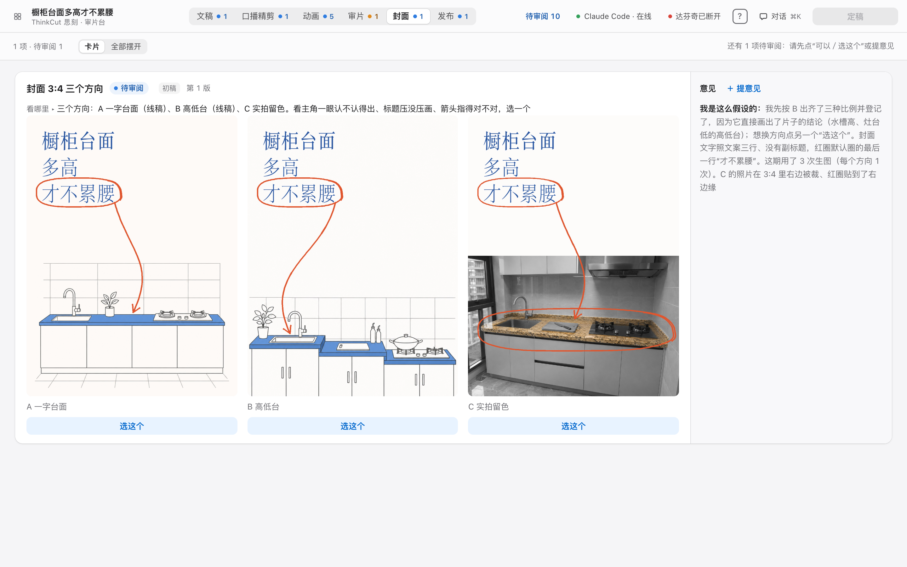
</picture>

AI 按你的 IP 配置先出 3:4 的几个方向，你点“选这个”；选定后点“出全部比例”，它才出 4:3、16:9。点图看大图，“全部摆开”把所有方向、所有版本摆成一面墙，能选两张并排比，每张下面都能直接提意见。封面文字在文稿栏改，这里只看画。

### 发布

<picture>
  <source media="(prefers-color-scheme: dark)" srcset="docs/screenshots/publish-dark.png">
  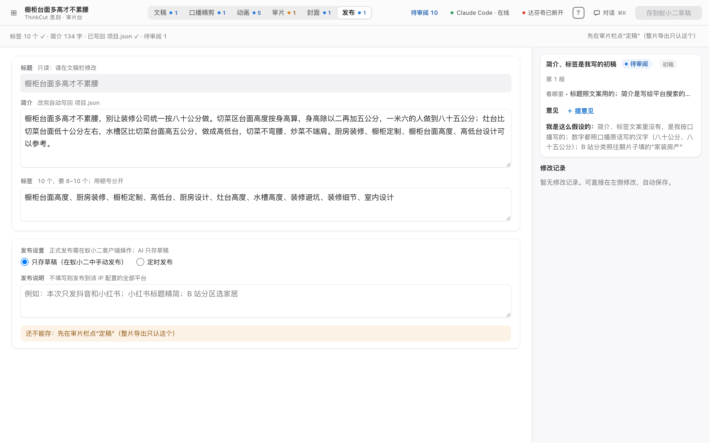
</picture>

发布前最后一步：标题（只读，在文稿栏改）、简介、标签三个框，AI 已经写好初稿，你直接改，自动保存并检查（标签 8–10 个、数字只用口播里说过的）。选“只存草稿”或“定时发布”＋时间（至少 10 分钟以后），点右上“**存到蚁小二草稿**”——**审片栏没点“定稿”时是灰的**。AI 导出成片、存档、封存，再存成各平台草稿。**AI 只存草稿，绝不点发布。**“发布说明”里可以写只发哪几个平台之类，不写就按 IP 配好的平台全发。

### 设置

<picture>
  <source media="(prefers-color-scheme: dark)" srcset="docs/screenshots/settings-dark.png">
  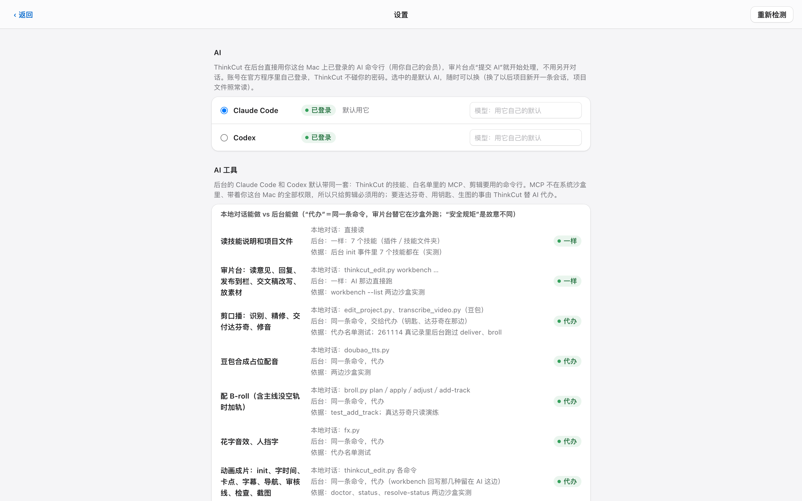
</picture>

首页右上“设置”，或审片台右上 AI 状态里的“打开设置”。

- **AI 工具**：两个 AI（Claude Code、Codex）在后台各能用什么：ThinkCut 的技能、命令行和依赖、MCP（每个能做什么、为什么不给），缺什么、怎么补；“一键补齐技能链接”。还有一张对照表，逐项写本地对话怎么做、后台怎么做、差在哪。
- **AI**：自动列出这台 Mac 装了哪些 AI 命令行（Claude Code、Codex）、登没登录。没登录的点“登录”，会弹出“终端”跑官方的登录命令（Claude Code 是 `claude auth login`，Codex 是 `codex login`），**账号你自己登，程序不碰密码**；登好回来会自动刷新。选一个当默认，随时能换（审片台右上角点 AI 状态也能直接换）。一般“模型”留空；它自己设置的模型你的账号用不了（页面会这么提示）时，在“模型”里填一个能用的。
- **豆包语音**：粘贴 Key 点“保存”（存进这台 Mac 的钥匙串，不显示、不写文件），点“测试”会用系统朗读生成两秒的话实测识别一次（按量计费，几分钱以内）。
- **蚁小二**：粘贴 Key 点“保存”（存进钥匙串里 `yxer-safe` 用的那一条）。蚁小二的命令行工具还是要先装：`bash projects/bin/setup_mac.sh`。

也可以照老办法在终端里配：豆包语音运行 `python3 core/bin/doubao_credentials.py`（在弹出的本机网页里输入）；蚁小二先 `bash projects/bin/setup_mac.sh`，再 `yxer-safe key set`（输入时不显示）。

### 和 AI 配合：提交 AI、AI 正在做什么

<picture>
  <source media="(prefers-color-scheme: dark)" srcset="docs/screenshots/ai-working-dark.png">
  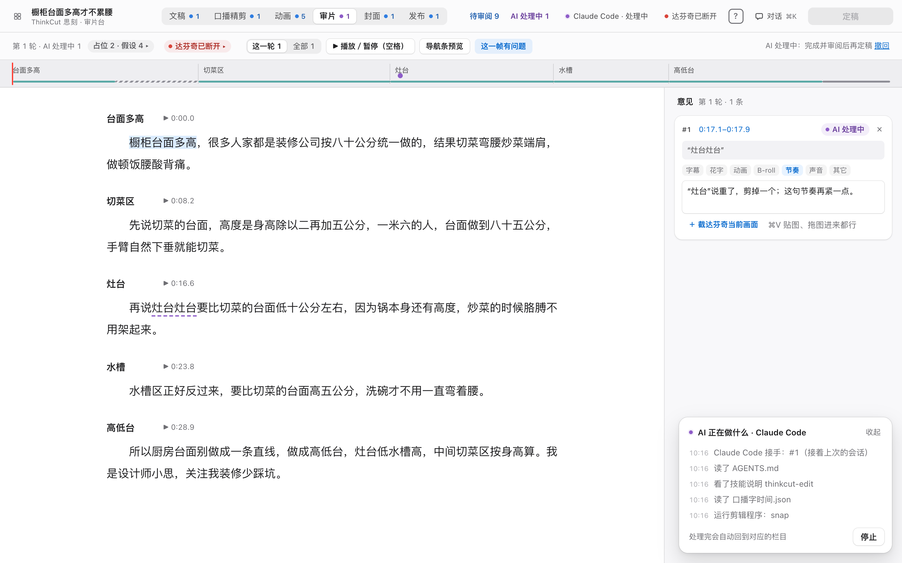
</picture>

点“提交 AI”就行：审片台在后台直接让“设置”里选的 AI 处理这一栏的意见，工作目录是这个项目的文件夹，每个项目记着自己那条 AI 会话、下次接着用（换了 AI 就新开一条）。

- 右上角写当前 AI 和状态：**未装／未登录／在线／处理中／出错**（出错会写原因和怎么办）。
- 处理时右下角有一张“**AI 正在做什么**”的小卡，写它在读什么、交了什么，有“**停止**”按钮；停了以后没做完的回到“待提交”。
- AI 要问你，会在那条意见下面提问、给选项按钮，你回答后再点“提交 AI”。
- AI 没登录或没装时，你点的会显示“**已存下，等 AI 上线**”，在“设置”里登录好以后自动开始。

### 对话侧栏（⌘K）

<picture>
  <source media="(prefers-color-scheme: dark)" srcset="docs/screenshots/chat-dark.png">
  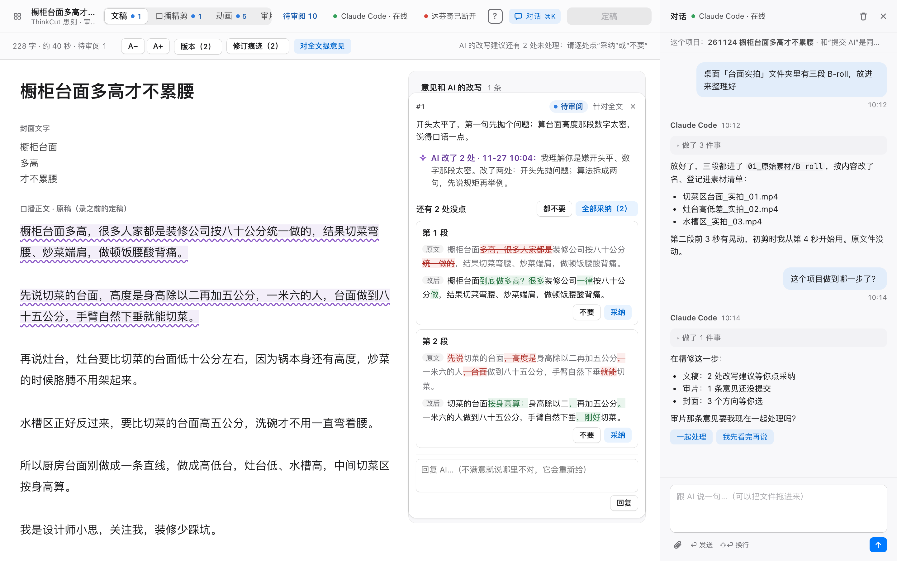
</picture>

首页和审片台顶栏右边都有“**对话 ⌘K**”，点它或按 ⌘K 从右边滑出对话栏（页面跟着变窄，不盖住内容；按住左边缘能拖宽），再按一次收起。

- **在审片台里**：对话属于这个项目，和“提交 AI”是**同一条会话**，AI 记得前面做过什么。可以说“把桌面上那三段 B-roll 放进来整理好”“这个项目到哪一步了”“存档一下”。
- **在首页**：专管首页——开项、在项目之间找、看哪些在等你、存档。**某个项目里面的事在那个项目自己的对话里做，不混在一起**：首页开完项，AI 把你这句话带进新项目的对话，点“进入项目”就到那边接着说（点“接着做这件事”就开始）。
- 用的 AI 和模型就是右上角选的那个，你不换它就不换。
- **放文件**（在项目里）：直接把文件拖进对话栏（或点回形针），放进这个项目的 `01_原始素材`（同名不覆盖、自动改成“名字 (2)”，大文件也行，传一半断了不留半截，和文稿栏的素材条是同一套），再交给 AI 归类、改名、登记。文件夹拖不进来时，直接告诉 AI 文件在哪（完整路径），它会复制进来。
- 回复一边出一边显示，下面列着它做了哪几件事；回复中能点“**停止**”。AI 要你选时给按钮，点了就当你回了那句。没登录、出错会说清楚原因和下一步。
- **斜杠命令**：输入 / 弹出能用的命令，如 /goal（让 AI 一直做到目标达成）、/compact、/context、ThinkCut 的技能，和 /clear、/stop、/model、/help；后台用不了的会说清原因，改权限、关沙盒的命令不放行。
- **能做的和本地一样**：后台 AI 能做的和你平时在 Claude Code／Codex 对话里用 ThinkCut 做的一样（Blender 镜头、导航条出片、素材库、交反馈单、新建 IP 等），只是导出、发布、定稿只认页面，删除进回收站，不给钥匙、不联网。
- **导出整片、上传发布、定稿只认你在页面上亲手点**：在对话里说“导出吧”“发布吧”“定稿”，程序直接回一句并给“去审片栏”“去发布栏”的按钮，不交给 AI；AI 自己也跑不了导出和上传。它删东西只能挪进回收站。
- 记录存在项目里（`审片工作台/对话.json`；首页的在程序数据文件夹 `ThinkCut/首页对话/`），重开还在；右上角垃圾桶清空。

<details>
<summary><b>老办法：在你自己打开的 Claude Code／Codex 对话里干活</b></summary>

1. **在这个文件夹里打开 Claude Code 或 Codex**，让它先读根目录的 [AGENTS.md](AGENTS.md)（给 AI 的地图和规矩；Claude Code 会从 [CLAUDE.md](CLAUDE.md) 自动指过去）。各技能的说明在技能文件夹的 `SKILL.md` 里，AI 会自己读。
2. **点“提交 AI”就行**（2026-11-26 起）：审片台在后台直接让“设置”里选的 AI 处理这一栏的意见，工作目录是这个项目的文件夹，每个项目记着自己那条 AI 会话、下次接着用（换了 AI 就新开一条）。
   - 右上角写当前 AI 和状态：**未装／未登录／在线／处理中／出错**（出错会写原因和怎么办）。
   - 处理时右下角有一张“**AI 正在做什么**”的小卡，写它在读什么、交了什么，有“**停止**”按钮；停了以后没做完的回到“待提交”。
   - AI 要问你，会在那条意见下面提问、给选项按钮，你回答后再点“提交 AI”。
   - AI 没登录或没装时，你点的会显示“**已存下，等 AI 上线**”，在“设置”里登录好以后自动开始。
   - 后台的 AI 权限是收住的：只能改这个项目文件夹（和临时文件夹），不能替你点“可以”“定稿”“采纳”，不能导出整片、不能发布（只存蚁小二草稿）。它拿不到豆包、蚁小二的 Key：要识别、配音、存草稿时由 ThinkCut 替它去调，只把结果给它。
   - 用 Codex 时它自己的命令不联网；要连达芬奇、识别配音、生图、存草稿的那几步由 ThinkCut 替它跑，照常能做。

   **随时跟 AI 说一句：对话侧栏**（2026-11-27 起）。首页和审片台顶栏右边都有“**对话 ⌘K**”，点它或按 ⌘K 从右边滑出对话栏（页面跟着变窄，不盖住内容；按住左边缘能拖宽），再按一次收起。
   - **在审片台里**：对话属于这个项目，和“提交 AI”是**同一条会话**，AI 记得前面做过什么。可以说“把桌面上那三段 B-roll 放进来整理好”“这个项目到哪一步了”“存档一下”。
   - **在首页**：专管首页——开项、在项目之间找、看哪些在等你、存档。**某个项目里面的事在那个项目自己的对话里做，不混在一起**：首页开完项，AI 把你这句话带进新项目的对话，点“进入项目”就到那边接着说（点“接着做这件事”就开始）。
   - 用的 AI 和模型就是右上角选的那个，你不换它就不换。
   - **斜杠命令**：输入 `/` 弹出能用的命令。`/goal 目标`（AI 一直做到达成；用 Codex 时 ThinkCut 把它改写成普通要求）、`/compact`、`/context`（Claude 才有）、`/thinkcut-project` 等技能，以及 ThinkCut 自己的 `/clear` `/stop` `/model` `/help` `/settings`。改权限、关沙盒的命令一律不放行；导出、发布、定稿照旧只认页面上点。
   - **放文件**（在项目里）：直接把文件拖进对话栏（或点回形针），放进这个项目的 `01_原始素材`（同名不覆盖、自动改成“名字 (2)”，大文件也行，传一半断了不留半截，和文稿栏的素材条是同一套），再交给 AI 归类、改名、登记。文件夹拖不进来时，直接告诉 AI 文件在哪（完整路径），它会复制进来。
   - 回复一边出一边显示，下面列着它做了哪几件事；回复中能点“**停止**”。AI 要你选时给按钮，点了就当你回了那句。没登录、出错会说清楚原因和下一步。
   - **导出整片、上传发布、定稿只认你在页面上亲手点**：在对话里说“导出吧”“发布吧”“定稿”，程序直接回一句并给“去审片栏”“去发布栏”的按钮，不交给 AI；AI 自己也跑不了导出和上传。它删东西只能挪进回收站。
   - 记录存在项目里（`审片工作台/对话.json`；首页的在程序数据文件夹 `ThinkCut/首页对话/`），重开还在；右上角垃圾桶清空。

   **老办法照样能用**：在自己打开的 Claude Code／Codex 对话里让它挂着等（对 AI 说“看审片台”或“看思刻”），对话里的 AI 在等时，提交的事交给它，不起后台 AI：

   ```bash
   python3 studio/skill/thinkcut-edit/scripts/thinkcut_edit.py home --wait
   ```

   （Claude Code 放后台跑；Codex 前台跑时加 `--wait-timeout 1500`，到时间没人点就再跑。）只做一个项目时也可以用 `workbench <项目文件夹> --wait`。连上了，审片台右上写“在线（对话）”，首页项目名后面有个绿点。
3. **常用说法**（对 AI 说，它会找对应的技能）：

   | 你说 | AI 做什么 |
   |---|---|
   | “开个项目，叫 XXX” | 建项目文件夹（thinkcut-project） |
   | “整理素材” | 把素材按 A roll／B roll／音乐归类、改名、登记 |
   | “剪一下这条片子”“剪一下这个项目”“剪口播” | 转文字、剪口播、放进达芬奇（thinkcut-edit） |
   | “配 B-roll”“做动画”“加花字音效”“做导航条” | 剪辑里对应的那一步 |
   | “做封面” | 出封面方向（thinkcut-cover） |
   | “导出成片” | 只在审片栏点了“定稿”之后才导出 |
   | “上传”“存草稿” | 存蚁小二草稿（thinkcut-upload） |
   | “看审片台”“看思刻” | 挂上 `--wait` 等你点 |
   | “反馈”“收尾” | 把这次的问题和新定的规矩整理成反馈单（thinkcut-feedback） |
   | “片子做到哪了”“这个项目做到哪了” | 跑 `thinkcut_edit.py status <项目文件夹>` 看进度和下一步 |

4. **AI 不能做的**：替你点确认、替你点发布、删你的数据、对外发消息——这些都要你自己来，或它先问你。

</details>

### 多个 IP

一个 IP（一个账号、一个人设）一套配置。程序自带的公共层在程序文件夹的 `profiles/` 里；你自己的 IP 放在程序文件夹旁边的 `ThinkCut配置档/`（这样升级程序不会动它，`python3 bin/thinkcut_config.py where` 能查到位置）。首页左上角能切换、新建、删除 IP。

<details>
<summary>配置档里有什么、常用命令</summary>

- `profiles/公共.json`：所有 IP 共用的默认值（片子文件夹、画幅、字体、发布平台……）。
- `ThinkCut配置档/<IP>/ip.json`：这个 IP 和公共层不一样的地方：封面颜色和字体、配音音色、画幅、发布平台、领域词、成图文件名开头等。
- `ThinkCut配置档/<IP>/规矩.md`：给 AI 看的这个 IP 的口吻、品牌、偏好（AI 做这个 IP 的项目时先读它）。
- `ThinkCut配置档/<IP>/词库.txt`（可选）：这个 IP 自己的专有名词，校对字幕时用。
- `profiles/本机.json`（可选，不进存档）：这台电脑自己的设置，比如默认 IP、项目放别处。

看有哪些 IP、默认是谁：

```bash
python3 bin/thinkcut_config.py list
```

新建一个（从 `示例IP` 复制）：

```bash
python3 bin/thinkcut_config.py new 新名字
```

看某个 IP 合并后的配置、给 AI 看的规矩：

```bash
python3 bin/thinkcut_config.py show --ip 新名字
```

```bash
python3 bin/thinkcut_config.py rules --ip 新名字
```

建项目时指定 IP：`python3 projects/bin/project.py init "项目名" --ip 新名字`（不写用默认 IP）。项目的 `项目.json` 里记着它属于哪个 IP，之后封面颜色、配音音色、发布平台都按这个 IP 来。

</details>

## 安全设计

- **两道闸只有你能放行**：**整片导出**要你在审片栏点“定稿”（点了以后内容又变了，要重新点）；**正式发布**永远是你自己在蚁小二客户端里点，程序只存草稿，并且拦截发布命令。在对话里说“导出吧”“发布吧”不算，AI 也替你点不了。删你的数据、对外发消息、付款这类事也一样，AI 会先问你。
- **AI 在沙盒里**：后台 AI 只能改这个项目文件夹（和临时文件夹），跑的命令不联网（Claude Code 用它自带的沙盒，Codex 的命令关网），不能替你点“可以”“定稿”“采纳”。不用任何绕过权限的参数。后台默认只带 ThinkCut 自己的技能，不带能控制电脑或浏览器的 MCP。
- **达芬奇 MCP 有护栏**：后台 AI 能用达芬奇 MCP 看和小改当前工程，但渲染导出、删除、切换工程、装插件这类工具整个禁用；别处正在写达芬奇时它不写。
- **钥匙不交给 AI**：豆包语音、蚁小二的 Key 在这台 Mac 的钥匙串里，后台 AI 的环境拿不到。要识别、配音、存草稿、连达芬奇、生图时，AI 交一张单子，由审片台代办：只跑名单里的自家程序、路径限在项目里、输出里抹掉钥匙，只把结果给它。
- **你的数据都在本机**：程序不会动你的原始素材，不会覆盖你在达芬奇里手改过的片段、字幕、花字、音效（手改过的就是定稿），不会做你没点头的导出或发布。删除项目只是挪进回收站。

<details>
<summary><b>你的数据放在哪</b></summary>

- **每个项目的东西都在它自己的项目文件夹里**：`01_原始素材`（原片）、`02_制作`（剪辑工程、动画、审片台记录、达芬奇工程）、`03_成片`（成片、封面、文案、字幕）。达芬奇工程建在项目自己的库里（`02_制作/达芬奇工程`），不用你电脑上的默认库。
- **审片台的记录**在 `02_制作/自动剪辑/审片工作台/`：你点的、写的、AI 回的、文稿的每一个版本都在这里。不要手改这些文件。
- **程序自己的东西**在这个文件夹里：程序、技能说明、配置档、素材库（字体、音效、素材索引）。
- **Mac 上还会留的**：5 个技能链接、程序环境的运行副本（可以删，用 `bash bin/sync_env.sh` 恢复）、审片台按空格的小服务（可以删，下次自动重建），以及用完就删的临时文件。
- **密钥**：豆包 Key 和蚁小二 Key 都在这台 Mac 的钥匙串里（豆包以前放的 `core/secrets/` 照读，已被 git 忽略）。不进存档、不写进文档、不贴给 AI。
- **AI 设置**：选了哪个 AI、填的模型名存在 `~/Library/Application Support/ThinkCut/AI引擎设置.json`（只有名字，没有账号和钥匙）；每个项目的 AI 会话号和最近一次处理的要点在项目的 `02_制作/自动剪辑/审片工作台/AI引擎.json`，AI 原始输出在同目录 `AI记录/`（排查用）。
- **AI 对话记录**：项目里的在 `02_制作/自动剪辑/审片工作台/对话.json`（拖进来的文件照样记在同目录 `备料.json`）；首页的在 `~/Library/Application Support/ThinkCut/首页对话/`（`对话.json` 和 AI 的工作区）。对话栏右上角能清空。

</details>

## 常见问题

<details>
<summary>点了“提交 AI”没反应、主按钮是灰的、达芬奇灯是红的……</summary>

- **我点了“提交 AI”，没反应？** 看右上角 AI 的状态：“未装”“未登录”时你点的只是存下了（意见上写“已存下，等 AI 上线”），打开“设置”装好或登录就会自动开始；“出错”时点开看原因（常见的是会员额度用完、模型账号用不了、断网）。
- **想换 AI？** “设置”里选另一个，或点右上角 AI 状态直接换；这个项目下次提交时新开一条会话，项目文件照常读。
- **主按钮是灰的？** 看工具栏下面一行右边写的原因：通常是还有“待审阅”的没处理，或 AI 正在改。
- **按空格达芬奇不动？** 第一次要给系统 Python 开 macOS“辅助功能”权限（页面会说怎么开）；达芬奇要开着这个项目的工程、停在剪辑页。
- **达芬奇灯是红的？** 达芬奇没开，或开的不是这个项目的工程。只影响审片栏，其余栏照常。
- **双击 ThinkCut 打不开，说无法验证开发者？** 第一次要在“应用程序”里右键 →“打开”。
- **把程序文件夹挪了地方？** 重新跑 `bash bin/setup_mac.sh --links` 和 `bash bin/build_app.sh --install`。
- **删错了项目？** 删除只是挪进 `#recycle/ThinkCut/`：马上点底下的“撤销”；过了就在 Finder 里把那个文件夹拖回来、去掉名字后面的时间。
- **体检说缺环境？** 见“现在的限制”：程序环境还不能从零一键装好。

</details>

## 给想改程序的人

<details>
<summary>文件夹一览、离线测试</summary>

| 文件夹 | 管什么 |
|---|---|
| `studio/` | 剪辑总入口、动画成片、字幕、音效、审核线、导出、审片台和首页 |
| `core/` | 剪口播、配画面、达芬奇里的花字音效、素材库工具 |
| `chapters/` | 章节导航条 |
| `cover/` | 封面 |
| `projects/` | 建项目、整理素材、存档、上传草稿 |
| `profiles/` | 每个 IP 一套配置 |
| `bin/` | 安装、环境、配置、Mac 程序外壳 |
| `design/` | 界面规格（颜色、线、圆角、阴影、字号，全站唯一一份） |
| `docs/` | 本说明用的截图（`screenshots/`）、配图（`images/`）、每版的发布说明（`releases/`） |

各文件夹自己的说明在它们的 `README.md` 里；给 AI 看的完整地图在 [AGENTS.md](AGENTS.md)。

**离线测试**：不连达芬奇、不开浏览器、不生图。先装好 `requirements/dev.txt` 里的包、ffmpeg（要带 zscale，`brew install ffmpeg-full`）、Node，再放好字体（音效库测试用不到）：

```bash
bash bin/fetch_fonts.sh
```

```bash
python3 bin/test_all.py
```

全套约 5 分钟。GitHub 上每次推到 main 或开合并请求也会自动跑这一套（`.github/workflows/test.yml`）。只跑某一块：`python3 bin/test_all.py cover`。Python 包清单在 `requirements/`：`base.txt` 日常用，`dev.txt` 跑测试用；`align.txt`、`matting.txt`、`resolve-mcp.txt` 是转写对齐、抠人、达芬奇连接各自环境的版本记录。

**重出本说明的截图**：`python3 bin/readme_shots.py`（用一个演示项目起首页和审片台，无头 Chrome 截浅色、深色两套，2 倍高清）。

</details>

## 许可证

本项目以 [PolyForm Noncommercial 1.0.0](LICENSE.md) 授权：个人、学习、研究、非营利用途可以自由使用和修改；**商业用途需另行取得作者授权**。随仓库带的第三方代码（GSAP、three.js）和要自己装的组件（如 ffmpeg）遵循各自的许可证，见 [THIRD_PARTY_NOTICES.md](THIRD_PARTY_NOTICES.md)。

反馈和参与见 [CONTRIBUTING.md](CONTRIBUTING.md)，安全问题见 [SECURITY.md](SECURITY.md)。

## 更新说明

每版变化见 [RELEASE_NOTES.md](RELEASE_NOTES.md)；每个版本给使用者看的发布说明（带图）在 [docs/releases/](docs/releases/)，也会贴在 GitHub 的 Releases 页面。

Licensed under PolyForm Noncommercial 1.0.0 — free for noncommercial use; commercial use requires a separate license from the author.
