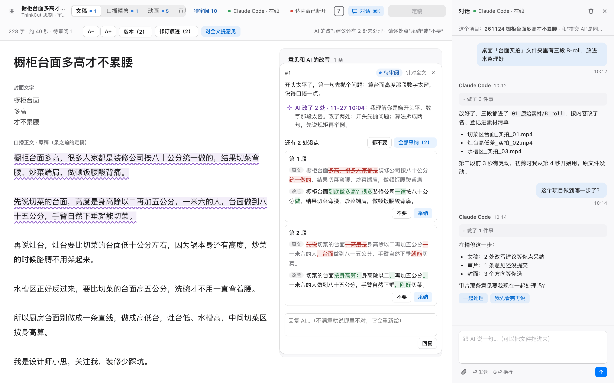
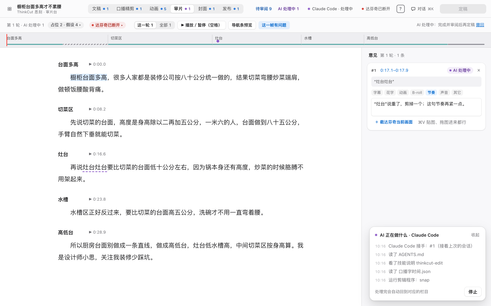

<!-- GitHub Release 说明：2026-11-26.1 到 2026-11-27.2（标签 v2026.11.27.2）。贴进 Release 时整页复制；图片用的是公开仓库 main 上的地址。 -->

# ThinkCut · 思刻 2026-11-27.2

**这几版的大事：AI 在程序里直接干活了。** 点“提交 AI”，ThinkCut 在后台叫起你这台 Mac 上已经登录好的 Claude Code 或 Codex，不用再开一个对话挂着等；想跟 AI 说一句，按 ⌘K 打开对话侧栏。AI 跑在沙盒里，拿不到你的 Key。

包含 2026-11-26.1 到 2026-11-27.2 共 7 个版本的变化。

<picture>
  <source media="(prefers-color-scheme: dark)" srcset="https://github.com/devinwu2012/thinkcut/raw/main/docs/screenshots/chat-dark.png">
  
</picture>

## 新增

- **点“提交 AI”就有 AI 处理**：ThinkCut 在后台让“设置”里选的 Claude Code 或 Codex 处理这一栏的意见，每个项目记着自己那条 AI 会话。右下角“AI 正在做什么”写它在读什么、交了什么，随时能“停止”；AI 要问你时在意见下面提问、给选项按钮。（2026-11-26.1）
- **设置页**（首页和审片台都能进）：看这台 Mac 装了哪些 AI、登没登录，点“登录”在终端里用你自己的账号登；配豆包语音 Key（能实测识别一次）和蚁小二 Key。Key 存在钥匙串里，不显示、不写文件。（2026-11-26.1）
- **AI 对话侧栏 ⌘K**：首页和审片台右上角“对话”。项目里的对话和“提交 AI”是同一条会话，可以说“把桌面上那三段 B-roll 放进来整理好”“这个项目到哪一步了”，也能直接把文件拖进对话；首页的对话管开项、找项目、存档，开完项把话带进新项目。导出、发布、定稿在对话里说了不算，只认你在页面上亲手点。（2026-11-27.2）
- 顶部栏目可以按住拖动换顺序，右键恢复默认；点右上角 AI 状态直接换用哪个 AI。（2026-11-26.1）
- 点了“开始制作”后，口播精剪栏显示“AI 正在初剪”，做完自动换成剪辑器。（2026-11-26.1）

<picture>
  <source media="(prefers-color-scheme: dark)" srcset="https://github.com/devinwu2012/thinkcut/raw/main/docs/screenshots/ai-working-dark.png">
  
</picture>

## 安全

- **钥匙不交给 AI**：后台 AI 的环境拿不到豆包、蚁小二的 Key。要识别、配音、存草稿、连达芬奇、生图时，由 ThinkCut 替它跑名单里的自家程序（路径限在项目里，输出里抹掉钥匙），只把结果给它。导出、上传照旧只认你在页面上的“定稿”。（2026-11-26.1）
- **AI 在沙盒里**：Codex 的命令不联网；Claude Code 也放进它自带的系统沙盒，只能写项目和临时文件夹、不联网、读不到钥匙串。（2026-11-26.1、2026-11-26.5）

## 变更

- 界面全部重画细节：配色、细线、圆角、阴影、字号、动效统一成一套“界面规格”，浅色、深色各一套；排版和用法不变。（2026-11-26.1）
- “配音试听”栏去掉，要你听的配音、对比改在口播精剪栏右上角“要你听”里听。（2026-11-26.1）
- 封面先出 3:4 让你选，选定后点“出全部比例”才出 4:3、16:9。（2026-11-26.1）
- 文稿栏去掉“在别处写好了？”贴字框：正文空着时直接把一大段贴进正文，自动分出标题和封面文字（存成一版，可以退回）。（2026-11-27.1）
- 自己构建的“ThinkCut 开发版”在页面标题旁一直挂橙色“开发版”，窗口标题加【开发版】；正式版没有。（2026-11-27.1）

## 修复

- AI 不在线时不再同时显示“AI 处理中”和“AI 离线”：改成“已存下，等 AI 上线”，上线后自动开始。（2026-11-26.1）
- 文稿栏“版本”浮层不再贴窗口左边被切掉、盖住标题。（2026-11-26.1）
- Mac 程序的设置页不再把已装好的 Claude Code、Codex 显示成“未装”，蚁小二不再误报“没装命令行”。（2026-11-26.4）
- `bash bin/fetch_fonts.sh` 改从官方“简体中文子集”字体包下载思源黑体、思源宋体，和测试用的一致。（2026-11-26.1）
- 没有本机签名证书时，`bash bin/build_app.sh` 照样用临时签名构建（以前会静默退出）。（2026-11-26.3）

## 升级

拿新代码后重新跑一次 `bash bin/build_app.sh --install`（装了 Mac 程序的话），打开“设置”登录 Claude Code 或 Codex。以前在终端里配过的豆包、蚁小二 Key 照常能用。

完整说明见 [README](https://github.com/devinwu2012/thinkcut#readme)；每版一句话的变化见 [RELEASE_NOTES.md](https://github.com/devinwu2012/thinkcut/blob/main/RELEASE_NOTES.md)。

---

# ThinkCut · 思刻 2026-11-27.2 (English)

**The big change: the AI now works inside the app.** Click “Submit to AI” and ThinkCut starts the Claude Code or Codex you are already signed in to on your Mac, in the background — no need to keep a chat open and waiting. Press ⌘K to talk to it. The AI runs sandboxed and never gets your API keys.

Covers 7 releases, 2026-11-26.1 through 2026-11-27.2.

## New

- **“Submit to AI” just works:** ThinkCut runs the Claude Code or Codex chosen in Settings on that column's comments, keeping one AI session per project. A small panel shows what the AI is doing, with a Stop button; when the AI needs you, it asks under your comment with option buttons. (2026-11-26.1)
- **Settings page:** see which AI command-line tools are installed and signed in, sign in through Terminal with your own account, and save the Doubao speech and Yixiaoer keys (stored in the Keychain, never shown or written to files). (2026-11-26.1)
- **AI chat sidebar (⌘K)** on the home page and review desk. On a project it shares the “Submit to AI” session — “bring in the three B-roll clips on my Desktop”, “where are we?” — and accepts dropped files; on the home page it creates and finds projects. Export, publish and finalize never happen from chat; they only count when you click them on the page. (2026-11-27.2)
- Drag the column tabs to reorder them; click the AI status to switch AI. (2026-11-26.1)
- After “Start”, the voice-over column shows “AI is making the first cut” and switches to the editor when done. (2026-11-26.1)

## Security

- **Keys stay out of the AI's reach:** the background AI's environment cannot read the Doubao or Yixiaoer keys. Transcription, TTS, draft uploads, DaVinci Resolve and image generation are run by ThinkCut on its behalf (allow-listed programs, project-folder paths only, keys scrubbed from output), returning only results. (2026-11-26.1)
- **Sandboxed AI:** Codex commands have no network; Claude Code also runs in its built-in system sandbox — write access only to the project and temp folders, no network, no Keychain. (2026-11-26.1, 2026-11-26.5)

## Changed

- Every screen redrawn to one UI spec (colors, hairlines, radii, shadows, type, motion), with separate light and dark themes; layout and behavior unchanged. (2026-11-26.1)
- The separate “voice preview” column is gone; listen to TTS and comparisons from “Listen” in the voice-over edit column. (2026-11-26.1)
- Covers: pick a 3:4 direction first, then click “All ratios” to get 4:3 and 16:9. (2026-11-26.1)
- Script column: paste a whole script into an empty body and the title and cover text are filled in automatically. (2026-11-27.1)
- Self-built development copies show an orange “开发版” (dev) badge; release builds don't. (2026-11-27.1)

## Fixed

- No more “AI working” and “AI offline” at the same time: submissions made while offline show “saved, waiting for the AI” and start automatically. (2026-11-26.1)
- The script column's “Versions” popover no longer gets cut off at the window edge. (2026-11-26.1)
- The Mac app's Settings no longer shows installed Claude Code / Codex as “not installed”. (2026-11-26.4)
- `bin/fetch_fonts.sh` downloads the official Simplified Chinese subset fonts, matching the tests. (2026-11-26.1)
- `bin/build_app.sh` falls back to ad-hoc signing when there is no local signing certificate. (2026-11-26.3)

Full documentation: [README](https://github.com/devinwu2012/thinkcut/blob/main/README.en.md).
