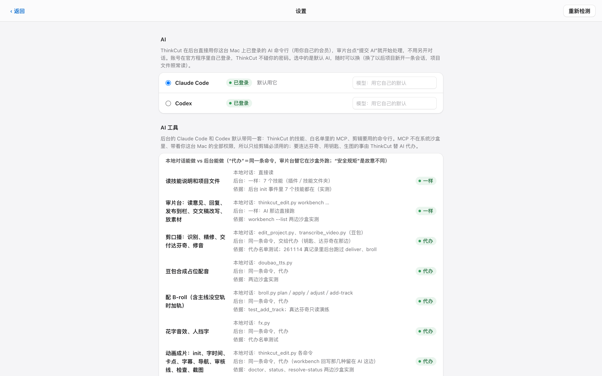

<!-- GitHub Release 说明：2026-11-27.3 到 2026-11-28.3（标签 v2026.11.28.3）。贴进 Release 时整页复制；图片用的是公开仓库 main 上的地址。 -->

# ThinkCut · 思刻 2026-11-28.3

**这几版的大事：剪口播更快，后台 AI 更全。** 口播 1.2 倍速改在达芬奇里设，不再把整条视频重压一遍；后台 AI 带齐了 ThinkCut 的技能，本地对话能做的它都能做，还能在护栏里用达芬奇 MCP；对话框支持斜杠命令。

包含 2026-11-27.3 到 2026-11-28.3 的变化。

<picture>
  <source media="(prefers-color-scheme: dark)" srcset="https://github.com/devinwu2012/thinkcut/raw/main/docs/screenshots/settings-dark.png">
  
</picture>

## 剪口播

- **1.2 倍速不再重压视频**：只把声音做成 1.2 倍速去识别、剪辑，放进达芬奇时用原片设 120% 速度。13 分钟口播从约 10 分钟、几 GB 降到十几秒、几十 MB。说“这条不加速”照旧，老项目不受影响。（2026-11-27.3）
- **人声剪好后整条修**：`edit_project.py polish` 一条命令在主线的副本上修音（主线不动），忽大忽小的段自动补齐。（2026-11-27.4）
- **有真口播就用真口播**：先用机器配音占位、后来剪好真口播的项目，口播精剪栏直接显示真口播；保存到达芬奇后项目自动换成真口播。（2026-11-27.5）
- 重剪口播后，口播精剪栏显示新剪的；新主线的画幅和上一版一样；轻声字尾不再留下长停顿。（2026-11-27.4）
- 换口播后字的时间跟着重算；在达芬奇里播放时，审片栏的高亮和时间条跟着往前走，暂停后对准达芬奇的实际位置。（2026-11-27.6）

## 后台 AI

- **斜杠命令**：对话框里输入 / 弹出能用的命令，如 /goal（让 AI 一直做到目标达成）、/compact、/context、ThinkCut 的技能，和 /clear、/stop、/model、/help。后台用不了的会说清原因，改权限、关沙盒的命令不放行。（2026-11-27.3）
- **带齐技能**：Claude 和 Codex 在后台都带同一套 ThinkCut 技能和剪辑要用的命令行，不再带和剪辑无关、能控制电脑或浏览器的 MCP；一律用中文回复。设置页新增“AI 工具”：每个 AI 能用什么、缺什么、为什么不给，一键补齐技能链接。（2026-11-28.1）
- **本地能做的后台都能做**：Blender 镜头、导航条出片、素材库、交反馈单、新建 IP 等都能在后台做；只剩导出、发布、定稿只认页面，删除进回收站，不给钥匙、不联网这些安全规矩不同。“AI 工具”里有逐项对照表。（2026-11-28.2）
- **达芬奇 MCP（带护栏）**：后台 AI 能用达芬奇 MCP 看和小改当前工程；渲染导出、删除、切换工程、装插件这类工具整个禁用，别处正在写达芬奇时它不写。（2026-11-28.2）
- 配 B-roll 时主线只有口播一条画面轨，AI 能先演练、再加一条空的 B-roll 轨（不动片段）；查达芬奇状态有专门的只读命令，不再卡住。（2026-11-28.1）

## 界面

- 窗口窄或打开对话栏时，审片台顶栏的栏目不再被挤没：栏目一直完整显示，AI 和达芬奇的状态先收成小圆点（点开照样能看、能换），实在太窄栏目可以左右滑、当前栏一直看得见；首页顶栏同样按宽度让位。（2026-11-27.4）

## 升级

拿新代码后重新跑一次 `bash bin/build_app.sh --install`（装了 Mac 程序的话），打开“设置”→“AI 工具”，缺技能链接就点“一键补齐”。

完整说明见 [README](https://github.com/devinwu2012/thinkcut#readme)；每版一句话的变化见 [RELEASE_NOTES.md](https://github.com/devinwu2012/thinkcut/blob/main/RELEASE_NOTES.md)。

---

# ThinkCut · 思刻 2026-11-28.3 (English)

**The big changes: faster voice-over cutting and a fully equipped background AI.** The 1.2× speed-up is now set in DaVinci Resolve instead of re-encoding the whole video; the background AI carries all of ThinkCut's skills, can do everything the local chat can, and can use the DaVinci Resolve MCP behind a guard; the chat box supports slash commands.

Covers 2026-11-27.3 through 2026-11-28.3.

## Voice-over cutting

- **1.2× without re-encoding:** only the audio is sped up for transcription and cutting; in Resolve the original clips get a 120% speed. A 13-minute voice-over goes from about 10 minutes and several GB to a dozen seconds and tens of MB. “No speed-up for this one” still works; older projects are unaffected. (2026-11-27.3)
- **Voice polish after the cut:** `edit_project.py polish` polishes the whole voice track on a copy of the main timeline (the main stays untouched) and evens out loud and quiet stretches. (2026-11-27.4)
- **Real voice-over wins:** in projects that started with a TTS placeholder, the voice-over column shows the real recording once it's cut, and the project switches to it after saving to Resolve. (2026-11-27.5)
- After a re-cut, the voice-over column shows the new cut, the new main timeline keeps the previous format, and soft word endings no longer leave long pauses. (2026-11-27.4)
- Word timings are recalculated after switching voice-overs; while Resolve plays, the Review column's highlight and timeline follow along and line up with Resolve when paused. (2026-11-27.6)

## Background AI

- **Slash commands:** type / in the chat box for /goal (keep working until a goal is met), /compact, /context, ThinkCut's skills, /clear, /stop, /model and /help. Commands the background can't run say why; ones that change permissions or turn off the sandbox are refused. (2026-11-27.3)
- **Fully equipped:** Claude and Codex both carry the same ThinkCut skills and command-line tools in the background, without unrelated MCP servers that could control the computer or a browser, and always reply in Chinese. New **AI tools** section in Settings: what each AI can use, what's missing and why, with one-click skill linking. (2026-11-28.1)
- **Same abilities as local chat:** Blender shots, chapter-bar rendering, the footage library, feedback forms, creating profiles and more now work in the background; only the safety rules differ (export/publish/finalize from the page only, deletes go to the recycle folder, no keys, no network). A side-by-side table is in AI tools. (2026-11-28.2)
- **DaVinci Resolve MCP, guarded:** the background AI can inspect and make small edits to the open project; render/export, delete, project switching and plugin installs are blocked, and it won't write while another session is writing to Resolve. (2026-11-28.2)
- When the main timeline has only the voice-over video track, the AI can dry-run and then add an empty B-roll track (clips untouched); a read-only command checks Resolve's state without hanging. (2026-11-28.1)

## Interface

- A narrow window or an open chat sidebar no longer squeezes out the column tabs: tabs always stay whole, the AI and Resolve status shrink to dots first (still clickable), and very narrow windows scroll the tabs with the current one in view; the home page's top bar adapts the same way. (2026-11-27.4)

Full documentation: [README](https://github.com/devinwu2012/thinkcut/blob/main/README.en.md).
